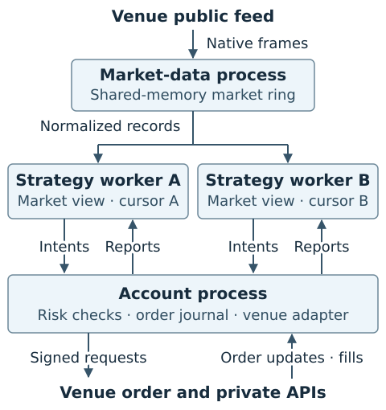

# Tickwire

Tickwire is a Rust trading engine for Linux. One market-data process can feed several strategy workers. Workers keep their own state and send orders to an account process that manages their shared cash and positions.

## Deploy two strategies

From the repository root, run the example on Linux with Python 3.11+, OpenSSL, GNU binutils and the toolchain pinned in `rust-toolchain.toml`.

```sh
python3 scripts/run-two-strategies.py
```

The launcher starts a local Bybit feed and two strategy processes. Both count market updates. Look for `two_strategies_observed`, two different worker PIDs and `quote_sequence: 1000000` in both checkpoints. Pass `--venue okx` to use OKX messages, or `--live` to read the public venue. The [launcher guide](crates/tickwire-md/examples/spot-market.md) shows the generated configuration.

## How an order reaches the venue



The publisher decodes each market event once. Workers consume the same ring at independent cursors and read their local market view in the strategy callback. A callback can return an order intent. The account gateway checks available funds, reserves exposure and writes the admission to its journal before sending the signed request. A fill updates the order, cash and fees. The account sends ordered reports back to the workers. The [system design](specs/implementation/single-host-trading.md) maps the calls to their owners and gives the latency measurement boundaries.

## Run a spot order

The simulated exchange supplies the book and the fills. This example places an order, processes a fill and cancellation, then reopens the journal.

```sh
cargo run --locked -p tickwire-mock --example spot-roundtrip
```

Look for `submit_calls=1 spent=101 held=1 recovered_frozen=true`. The final flag means the restarted account is waiting for reconciliation.

To run two orders through a native Bybit or OKX adapter, choose the venue and a fresh directory. Two local producers draw on the same account balance. Each receives the acknowledgement for its own order from the local TLS exchange.

```sh
cargo run --locked -p tickwire-spot-runner -- paper okx "$(mktemp -d)/account"
```

The final record reports `native_acknowledgements: 2` and `open_orders: 2`. The two outstanding orders reserve a total of 120 USDT.

## Exchange support

| Venue | Public market data | Trading and account access |
| --- | --- | --- |
| Binance | Spot and USD-M depth, trades and best bid/ask. Spot also supports SBE. | The file-configured runtime routes orders, consumes private reports and reconciles the account before enabling new orders. |
| Bybit | V5 spot `orderbook.1` | The adapter signs V5 spot limit orders, market orders, cancellations and queries. The account CLI reads private reports and balances. |
| OKX | V5 spot `bbo-tbt` | The adapter signs V5 cash limit orders, market orders, cancellations and queries. The account CLI reads private reports and balances. |

Bybit and OKX order paths run against a local TLS exchange in the paper example. Activating either account for live trading still requires durable private-stream recovery and reconciliation. See the [public data contract](specs/implementation/spot-quote-input.md) and [spot execution contract](specs/implementation/spot-execution.md) for supported messages and identity rules.

## Develop and measure

* Implement `Strategy::on_market` to inspect a quote and return an optional intent. The SDK includes a compiled spread example. [Strategy API](crates/tickwire-strategy-sdk/src/lib.rs) · [Example worker](crates/tickwire-strategy-example/README.md)
* Use `cargo bench --locked -p tickwire-md --bench spot_bbo_decode` to time a Bybit or OKX frame through integer quote decoding. For an order, measure callback, gateway admission, journal sync and first socket write separately. [Performance and data flow](specs/implementation/single-host-trading.md)
* Run the Linux process scenario to trace a Binance spot order through local TLS, the account and its journal. [Linux trading lab](crates/tickwire-lab/README.md) · [Test commands](scripts/README.md) · [Specification index](specs/INDEX.md)
