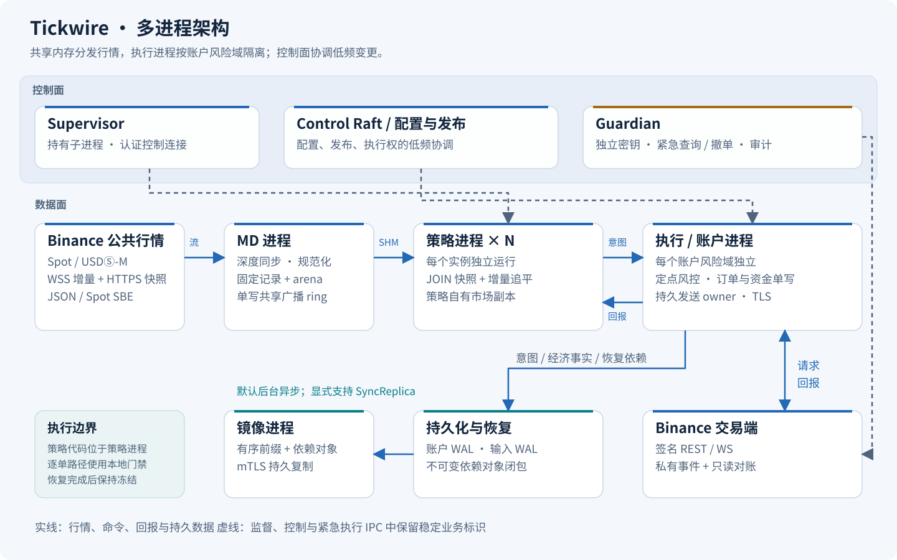
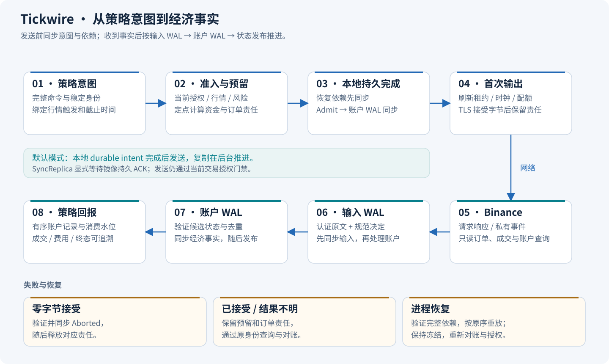
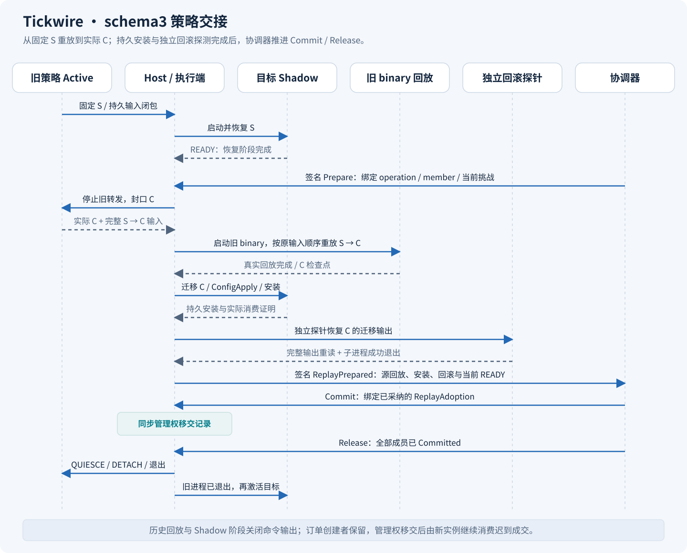

# Tickwire

面向 Binance Spot 与 USDⓈ-M 的 Rust 低延迟交易系统。

Tickwire 把行情接入、策略计算和账户执行放在独立进程中，通过共享内存传递行情、通过有界通道提交交易意图。系统围绕确定性风控、发送前持久化、可核验恢复和策略独立换代构建，面向需要控制延迟与故障行为的交易基础设施开发。

**当前处于实现后期。** Spot 行情到订单、成交、终态费用核对的完整链路已在 Linux 独立进程中跑通。生产资格、目标主机的全链路延迟以及跨主机故障接管仍待验证。

[实现状态](specs/20261020-implementation.md) · [规格索引](specs/INDEX.md) · [开发约定](AGENTS.md) · [验证脚本](scripts/README.md)

## 项目定位

项目以 Linux 为主要运行平台，使用 Rust 2024 edition 和固定的 Rust 1.99.1 工具链。核心计算采用定点数与有界数据结构；订单簿、风控和执行状态转换保持确定性，热路径避免堆分配与 I/O。系统集成层负责网络、持久化和进程生命周期。

- **进程隔离**：每个策略实例独立运行，执行与账户按风险域隔离。策略代码不进入执行进程，策略换代保留现有订单与交易连接。
- **固定协议**：共享内存 ring 与 SPSC 通道使用固定二进制 ABI；布局、编码与兼容边界由机器契约和 golden vectors 校验。
- **可恢复执行**：下单前同步本地意图与恢复依赖，收到成交后持久化经济事实。重放按原顺序重算状态，恢复完成后保持冻结，经过对账与授权再继续运行。
- **低频控制**：Raft 协调配置、发布与执行权。默认逐单路径采用本地持久化和后台异步复制；需要远端持久确认时显式选择 `SyncReplica`。

## 当前状态

| 范围 | 已实现 | 后续工作 |
|---|---|---|
| Spot 业务链 | 公开行情、真实 JOIN、独立策略、签名 REST、私有事件入账、订单与成交查询、终态费用闭合 | 更多订单类型、会话恢复与故障组合验收 |
| 行情与共享内存 | JSON / Spot SBE 接入，完整深度与精确事件发布，快照加增量追平，受保护借用与协作退出 | 完整 bank 轮换、死亡回收、生产缓存与 NUMA 资格 |
| 策略换代 | Shadow、完整输入记录、旧版本回放、持久安装与独立回滚探测；自定义 V1→V2 的 schema3 完整进程交接通过 | 多域故障组合、声明重建的运行时接线 |
| 账户与恢复 | 定点风险、多资产账户、有序 WAL、依赖闭包、冻结恢复与有序前缀复制 | USDⓈ-M 完整业务场景、外部成交及强平 / ADL 等事实分类 |
| 控制与配置 | 认证连接、持久 Raft、mTLS、快照、成员管理、配置对象和本地物化 | 常规配置计划与提交、操作状态和 watch 的业务接线 |
| 部署与性能 | Linux 进程实验场、组件基准、契约校验和分层 TLA+ 模型 | 目标主机压力与尾延迟、掉电 / 断网注入、跨主机隔离接管 |

具体能力与未完成项以[模块规格](specs/INDEX.md)为准。[部署契约](specs/contracts/deployment-reference-v1.json)中的 SLO 是验收目标，组件基准和测试用例数量不作为全链路性能指标。

## 架构

数据面从公开行情进入 MD 进程，经共享内存广播到各策略，再由执行进程完成风控、持久化与发送。Supervisor 持有子进程和认证连接；Guardian 使用独立身份执行受审计的紧急查询与撤单；控制面管理配置和执行权。



| 模块 | 主要实现 |
|---|---|
| 行情接入与分发 | `tickwire-md`、`tickwire-binance-public`、`tickwire-market-source`、`tickwire-market-publisher` |
| 策略托管与换代 | `tickwire-strategy-sdk`、`tickwire-strategy-host`、`tickwire-release`、`tickwire-handover` |
| 风控、账户与交易 | `tickwire-risk`、`tickwire-execution`、`tickwire-account*`、`tickwire-gateway`、`tickwire-binance-execution` |
| IPC 与持久化 | `tickwire-ipc`、`tickwire-shm*`、`tickwire-join`、`tickwire-journal`、`tickwire-recovery` |
| 控制与进程管理 | `tickwire-control*`、`tickwire-config-*`、`tickwire-supervisor`、`tickwire-lifecycle`、`tickwire-guardian`、`tickwire-replica` |
| 运行时装配 | `tickwire-app`；本地实验场由 `tickwire-lab` 提供 |

[标的索引](specs/implementation/instrument-index.md)将完整的 `u64` 标的标识映射为进程内部连续索引。固定目录在冷路径构建 mask / gather 索引，查询核对完整原键；动态目录使用只追加索引，预留容量内插入保持已有位置，扩容在冷路径完成。MD 启动时统一绑定本地盘口 key 和各 topic 的发布槽位，策略端用连续盘口集合和复用的深度工作区处理更新。IPC 中的稳定业务 ID 保持不变。当前 topic 目录仍固定，运行时新增标的或 feed 依赖受信目录发布与 JOIN，目录版本和权限由业务层管理。

行情发布器为每个 topic 复用 128 KiB 的解码与发布档位工作区，从深度或事件通知进入发布器到写入共享内存，健康路径不进行堆分配。回归覆盖首次事件、JSON/SBE、4096 档增量和 2 MiB 线程栈；网络接收和 WebSocket 帧解析仍有独立的存储开销。接口与预算见[行情发布规格](specs/implementation/binance-market-events.md)，实测范围见[发布路径验证](specs/evidence/20261028/publisher-hot.json)。

发送顺序以持久事实为边界：恢复依赖与 `Admit` 同步完成后，发送 owner 再检查当前门禁并向 TLS 交付字节。交易所输入先进入输入 WAL，账户事实同步后才发布新状态。持久收据证明落盘；交易权限由当前授权、租约和执行权门禁决定。



schema3 将换代拆成可核对的阶段。旧版本从固定检查点 S 重放到实际切点 C，目标版本在 C 上迁移并应用配置，完成持久安装和独立回滚探测。协调器采纳结果后推进 Commit / Release，旧进程退出后再激活目标。订单创建者身份保留，管理权移交后由新实例继续处理迟到成交。



## 快速开始

准备 Rust（通过 rustup 安装，仓库自动选择固定工具链）。首先构建并运行确定性 Spot 示例：

```sh
cargo build --workspace
cargo run -p tickwire-mock --example spot-roundtrip
```

该示例连接盘口、策略、定点风控、IPC、持久日志和 mock 交易所，覆盖成交、撤单与冻结恢复，无需 Binance 凭据。

完整进程实验使用本地 TLS / WebSocket 替身，实际启动 MD、策略、执行、复制与协调进程。以下脚本需要运行中的 Docker，构建和运行固定 Linux 镜像：

```sh
# Spot 下单、成交和费用闭合
./scripts/run-core-chain-linux.sh spot-fill

# 自定义 V1 → V2 策略的 schema3 交接
./scripts/run-core-chain-linux.sh spot-handover-custom

# 使用优化构建运行相同场景
./scripts/run-core-chain-linux.sh spot-handover-custom release
```

脚本将日志、账户报告和运行结果保存到 `.tools/lab-results/`，保留场景的 Linux volume 供检查。场景定义和原生 Linux 运行方法见 [tickwire-lab](crates/tickwire-lab/AGENTS.md)。

[reference.toml](config/reference.toml)描述模拟环境的结构与容量；[production.template.toml](config/production.template.toml)保留待填写的生产输入。实际进程配置由运行时装配与准入流程读取，格式及入口见 [tickwire-app](crates/tickwire-app/AGENTS.md)。

## 开发与验证

日常开发从目标 crate 的 `AGENTS.md` 和对应实现规格开始。行为变更先更新规格，再以 Red / Green 回归推进；ABI、风险、配置和部署变更同步机器契约。workspace 统一验证入口：

```sh
# 格式、所有目标的回归、文档测试和 Clippy
./scripts/check-rust.sh

# Linux 共享内存、FD 传递与多进程行为；需要 Docker
./scripts/check-linux.sh

# 定向回归与独立性能测量
cargo test -p tickwire-account
cargo bench -p tickwire-book --bench depth_apply
cargo bench -p tickwire-instrument-index --bench lookup
```

设计契约校验使用 Python 3.11+：

```sh
python3 -m venv /tmp/tickwire-env
/tmp/tickwire-env/bin/python -m pip install -r scripts/requirements-design.txt
/tmp/tickwire-env/bin/python scripts/verify-design-contracts.py --openapi
/tmp/tickwire-env/bin/python scripts/verify-documentation.py
```

执行、日志、账户、ring 和恢复等状态机另有 TLA+ 有限模型。模型与源码锚点一同维护，TLC 证据覆盖各模型声明的状态域和故障边界：

```sh
# 需要 Java；脚本校验并使用固定 TLC 版本
./scripts/check-tla.sh
python3 -m unittest discover -s scripts -p test_tlc_coverage.py
```

Raft 构建所需的 protobuf 3.x 由 [protoc-raft](scripts/protoc-raft)选择；Apple Silicon 环境使用随依赖提供的 x86_64 工具时需要 Rosetta。更多环境与单项命令见[脚本说明](scripts/README.md)。

## 文档导航

| 入口 | 内容 |
|---|---|
| [规格索引](specs/INDEX.md) | 按功能域查找模块、实现状态与机器契约 |
| [总体设计](specs/20261020-binance-ultra-low-latency.md) | 进程边界、延迟预算、故障与部署约束 |
| [实现进展](specs/20261020-implementation.md) | 阶段结果、验收证据与待办边界 |
| [模块实现规格](specs/implementation/README.md) | 接口、不变量、错误处理和验证要求 |
| [机器契约](specs/contracts/README.md) | IPC、风险、配置、部署的机器可校验定义 |
| [TLA+ 模型](tla/README.md) | 模型范围、源码锚点、运行方式与证据 |
| [贡献与工作约定](AGENTS.md) | 依赖方向、编码约束、规格与测试工作流 |

源码位于 `crates/`，每个 crate 有独立职责说明。`config/` 保存参考输入，`scripts/` 提供检查和实验入口，`assets/` 保存本文插图及其生成脚本。

## 许可

Tickwire 当前为私有、未发布项目。workspace 声明 `license = "UNLICENSED"`、`publish = false`，尚未授予开源许可。
