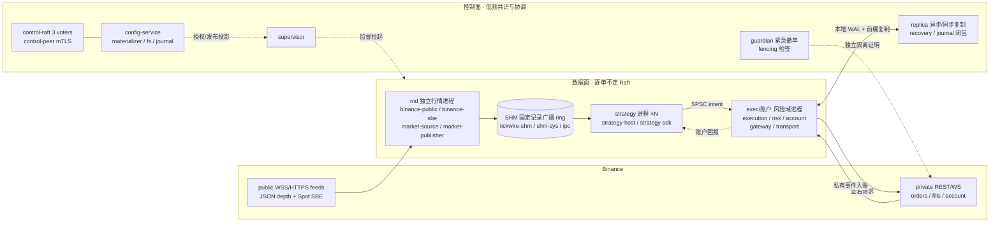

# Tickwire

> 面向 Binance Spot 与 USDⓈ-M 的 Rust 超低延迟生产交易系统：多进程隔离、共享内存广播 ring、定点风控、持久 WAL、控制面 Raft 与异步复制接管。

| 项目 | 状态 |
|---|---|
| 语言 / toolchain | Rust 1.99.1（仓库自带 `rust-toolchain.toml`，components: rustfmt, clippy），workspace edition 2024，resolver 3 |
| 版本 / 许可 | `0.1.0`，`license = "UNLICENSED"`，`publish = false` —— **私有未发布项目，未授予任何开源许可** |
| 实现阶段 | 实现后期：Spot 完整链路已在 Linux 独立进程跑通（含终态费用闭合）；生产资格与全链路性能**尚未验证** |
| 平台边界 | 数据面共享内存、控制传输与 WAL 恢复面向 Linux 设计；macOS 可跑纯逻辑/单测，真实多进程证据需 Linux（容器） |

> **当前状态请先读**：本仓库不是可直接上线的交易系统。设计目标、已跑通链路与未完成项严格区分见[当前实现状态](#3-当前实现状态)；任何性能数字都标注了测量边界，未实测的一律标为目标值/待验证。

---

## 目录

1. [特性一览](#1-特性一览)
2. [当前实现状态](#2-当前实现状态)
3. [宏观架构](#3-宏观架构)
4. [为低延迟做的设计与优化](#4-为低延迟做的设计与优化)
5. [目录结构](#5-目录结构)
6. [编译与运行](#6-编译与运行)
7. [测试与验证金字塔](#7-测试与验证金字塔)
8. [文档导航](#8-文档导航)
9. [配置与部署](#9-配置与部署)
10. [许可证与状态](#10-许可证与状态)

---

## 1. 特性一览

- **双市场覆盖**：Binance Spot 与 USDⓈ-M 合约共用同一套账户/风险/执行内核，按产品差异处理预留、保证金、资金费与减仓。
- **多进程隔离主架构**：独立行情进程、每策略实例独立进程、按账户风险域独立的执行进程，外加 supervisor 与 guardian 紧急执行进程；**策略代码不进入 exec 进程**，单策略升级/回滚不重启 OMS 与交易连接。
- **共享内存零拷贝广播 ring**：Disruptor 式固定记录单写多读 ring，单份 payload、多消费者游标/gating/barrier，活引用不可被覆盖，支持 bank 轮换与协作退出。
- **二进制 ABI + golden 向量**：Tickwire wire ABI 1.0 固定小端布局，设计契约含 46 个布局、734 个字段、31 种消息 ID、63 条编码 golden 向量与 25 条语义/畸形案例，Rust 回归与 Python 校验共用同一批向量。
- **SBE 固定 schema 行情解码**：Spot SBE（trade / bestBidAsk / depth20 / diff）编译期常量 schema，无运行时反射，mantissa/exponent 精确换算不使用浮点。
- **定点数风控**：`Fixed` 定点 i128 检查型计算，Spot 可用余额、USD-M 保证金/未实现亏损/执行费/平仓费/资金费全部走 Decimal 契约向量，杜绝浮点不确定与热路径分配。
- **真实 WAL 与确定性恢复**：物理 WAL v1（136B 头 / 40B 尾、同步批次、分段、manifest）、业务日志 schema2、账户有序日志与恢复依赖闭包；恢复按原事件顺序重放并保持冻结，不自动重发旧意图。
- **控制面 Raft，数据面不走共识**：逐单不经过 Raft 或远端确认；三 voter 持久 Raft（`raft 0.7.0`）只协调低频配置、发布与执行权。
- **本地持久意图 + 后台异步复制**：默认 `LocalDurable+AsyncReplica`（本地 durable intent 先于发送，异步前缀复制）；`SyncReplica` 为可选显式提交模式；副本缺可能已发送尾部时进入 EvidenceLost/Frozen。
- **统一配置控制面**：全局 schema、revision/hash 一致性、validate → plan → commit 投影、授权投影、回滚计划与本地四阶段（Prepared/Desired/RuntimeObserved/Effective）持久化。
- **TLA+ 形式化验证**：执行提交/崩溃回执/交易结果、广播 ring、控制会话、物理/业务日志、账户、盘口状态等分层有限模型，固定 TLC 1.7.4 复跑。

## 2. 当前实现状态

> 诚实声明：以下区分「已跑通」「部分实现（partial）」「未完成/待验证」。设计文档里的目标不等于已经实现。

### 2.1 已跑通 / 已实现

- **Spot 完整进程链在 Linux 独立进程运行通过**：公共行情订阅与深度桥接、独立策略进程经真实 JOIN 与 SPSC 通道收发行情/规范意图/账户回报、签名 REST 下单、私有事件入账、按原订单查询→成交分页→`FeesReconciled` 的终态费用核对；离线报告确认订单终态、`fee_reconciled=true`、`unknown=false`、无待处理订单，账户记录与镜像逐条一致。证据与阶段记录见 [specs/20261020-implementation.md](specs/20261020-implementation.md)。
- **核心原语已实现并有回归**：订单簿 reducer（`tickwire-book`）、定点风控（`tickwire-risk`）、wire ABI 编解码（`tickwire-ipc`）、执行内核（`tickwire-execution`）、多资产账户状态机与恢复编码（`tickwire-account` / `tickwire-account-codec`）、物理 WAL（`tickwire-journal`）、业务日志（`tickwire-business-journal` / `tickwire-journal-codec`）、非阻塞传输（`tickwire-transport`）、发送协调（`tickwire-gateway`）、Binance 协议签名与解码（`tickwire-binance`）、控制会话与 SEQPACKET 传输（`tickwire-control` / `tickwire-control-sys`）、Raft 适配器与 peer 服务（`tickwire-control-raft` / `tickwire-control-peer`）、本地配置物化（`tickwire-config` 系列）、异步复制源/镜像骨架（`tickwire-replica`）、guardian 验签与紧急撤单 owner（`tickwire-guardian` / `tickwire-fencing`）。
- **本地确定性闭环**：`cargo run -p tickwire-mock --example spot-roundtrip` 串起归一化盘口 → 策略 → 定点风险 → IPC → durable journal → mock 交易所 → 成交/撤单 → 冻结恢复，不需要凭据。

### 2.2 部分实现（partial，核心已落地、仍有明确待接线范围）

- `tickwire-shm`：固定记录广播、单消费者传输、受保护借用与协作退出已完成；owner/pending gate 完整组合、死亡回收（pidfd/holder registry）、完整 bank 轮换、Arena payload 与生产缓存行/NUMA 资格仍待续（见 [shm-ring.md](specs/implementation/shm-ring.md)）。
- `tickwire-config-service`：复制对象、desired、mTLS、角色授权与安全读已完成；计划器、常规提交、操作状态机与 watch 待续（见 [config-control-state.md](specs/implementation/config-control-state.md)）。
- 其余带「部分实现」标记的边界：SBE 独立业务 owner 接线、私有流完整轮换/业务关联、Spot 高级单类型化后的账户准入、WS 交易 owner、Raft 实际隔离网络组合、replica 真实故障接管、策略完整输入尾部回放与多域组合，均在 [specs/INDEX.md](specs/INDEX.md) 的状态表中标注。

### 2.3 未完成 / 待验证（不能当作已有能力）

- **生产资格未验证**：目标 Linux 主机的全链路 tick-to-socket 延迟、多标的真实录包压力、掉电/断网故障注入与跨主机实际隔离接管，均属后续 P5 验收；[deployment-reference-v1.json](specs/contracts/deployment-reference-v1.json) 中 `slo.measured = false`。
- **双产品完整组合**：USD-M 收入事实与完整风险范围、剩余订单类型、跨币种保证金、在线更换基线待实现。
- **配置发布与统一控制业务接线**：计划器/常规提交、协调器与 exec 重启组合、认证共识网络待完成。
- **既有阶段测试数为历史证据**：`specs/20261020-implementation.md` 记录的 macOS/Linux 测试总数与各模块用例数是对应提交快照下的结果，不随后续改动自动保持；以当前 `./scripts/check-rust.sh` 实际输出为准。

## 3. 宏观架构

系统分成**数据面**（行情 → 策略 → 执行/账户 → 交易所，逐单不经过共识）与**控制面**（Raft、配置、监督、复制、恢复，低频协调）。

### 3.1 宏观架构总览

```
                          ╔═════════════════ 控制面（低频，Raft 共识） ═════════════════╗
                          ║  control-raft (3 voters, raft 0.7.0)  ↔  control-peer      ║
                          ║  config-service / config-materializer / config-fs/journal   ║
                          ║  supervisor（子进程+认证连接）  guardian（独立紧急撤单/审计）║
                          ║  replica（异步/同步前缀复制）  recovery / journal（恢复闭包）║
                          ╚═══════════╤═══════════════════════╤═══════════════════════╝
                          授权/发布/接管信号 │                       │ 复制/恢复证据
        ────────────────────────────────────┼───────────────────────┼─────────────────────
   数据面                                    ▼                       ▼
 ┌────────────────────┐   WSS/HTTPS   ┌──────────────────────────────────────────────┐
 │ Binance public     │ ───────────▶ │ tickwire-md（独立行情进程）                    │
 │ Spot / USD-M feeds │  JSON/SBE    │  binance-public / binance-sbe / market-source │
 └────────────────────┘              └───────┬────────────────────── market-publisher ┘
                                             │ 固定记录广播 ring（SHM，单写多读）
                                             ▼
                                  ┌────────────────────┐  SPSC 规范意图（独立通道）
                                  │ 策略进程 ×N（独立） │ ────────────────┐
                                  │ strategy-host /    │                │
                                  │ strategy-sdk       │ ◀───────┐       │
                                  └────────────────────┘ 账户回报 │       ▼
                                        ▲ 行情副本/JOIN     │  ┌──────────────────────────────┐
                                        │                  │  │ exec/账户进程（按风险域独立）  │
                                        └──────────────────┘  │ execution / risk / account     │
                                            SHM ring          │ gateway / transport (TLS)      │
                                                              └───────┬──────────────┬─────────┘
                                                 签名 REST/WS 私有会话 │              │ 私有事件
                                                                      ▼              ▼
                                                            ┌──────────────────────────────┐
                                                            │ Binance private REST / WS  │
                                                            └──────────────────────────────┘
```

### 3.2 Mermaid 视图



### 3.3 进程职责

| 进程 | 职责 | 主要 crate |
|---|---|---|
| 行情进程（md） | 每标的有界网络 owner；WSS 订阅 + HTTPS 快照桥接序列，SBE/JSON 归一化后经 ring 发布；准入与服务 | `tickwire-md`、`tickwire-binance-public`、`tickwire-binance-sbe`、`tickwire-market-source`、`tickwire-market-publisher` |
| 策略进程（每实例独立） | 持有自有市场副本，产出规范意图，接收账户回报；Shadow 加载、换代、退休不影响他人 | `tickwire-strategy-host`、`tickwire-strategy-sdk` |
| 执行/账户进程（按风险域） | 风险准入、意图持久化到 WAL、授权后排队发送；成交/费用/终态按原序入账；冻结后仍允许有效 Cancel/Query | `tickwire-execution`、`tickwire-risk`、`tickwire-account*`、`tickwire-gateway`、`tickwire-transport` |
| supervisor | 持有子进程与认证控制连接，LaunchSpec/Registry/退出观察 | `tickwire-supervisor`、`tickwire-runtime-policy` |
| guardian | 独立、受审计的查询/撤单 owner，持独立密钥与 ED25519 隔离证明验签 | `tickwire-guardian`、`tickwire-fencing` |
| 控制面（raft/peer/config） | 三 voter 持久 Raft 承载配置对象、发布操作与安全读；本地四阶段物化 | `tickwire-control-raft`、`tickwire-control-peer`、`tickwire-config-*` |
| replica / recovery | 有序前缀异步/同步复制、源封口、冻结接管与恢复依赖闭包 | `tickwire-replica`、`tickwire-recovery`、`tickwire-journal` |

**数据面 / 控制面划分**：行情广播、意图、成交回报、资金更新都在数据面进程间完成，本地 durable intent 先落盘再发送，**不等 Raft、不等远端副本**；Raft 只用于配置变更、发布授权与执行权（writer epoch）这类低频决策。

## 4. 为低延迟做的设计与优化

> 每条按「设计 → 为什么降低延迟/风险 → 依据」给出。凡未在目标 Linux 主机实测的数字均标注「目标值/待验证」；组件数字不代表全链路。

### 4.1 共享内存零拷贝固定记录广播 ring

- **设计**：行情 payload 写一次到 memfd 映射的固定记录 ring，消费者通过各自游标 acquire-load 发布水位后借用；单写者、对齐 64 位原子访问，无锁排队（[shm-ring.md](specs/implementation/shm-ring.md)、[shm-mapping.md](specs/implementation/shm-mapping.md)）。
- **收益**：避免每读者一次序列化/拷贝与内核穿越；策略进程直接在读视图上计算，热路径无堆分配。
- **依据**：`crates/tickwire-shm`（Producer/Reader/Watermarks/Freeze/WriteClaim/ReadLease）、`crates/tickwire-shm-sys`（单写映射、seals、原子原语）。Linux 子进程测试覆盖 1/2/4/8/16/32 个消费者，每个读取 1,024 条记录、逐条校验序号与 512 字节内容；共享 ring 物理容量取 ABI 最小值 64（来源：[shm-ring.md](specs/implementation/shm-ring.md)、[scripts/README.md](scripts/README.md)）。设计 profile 的每 topic 消费者上限为 40（[ipc-wire-v1.json](specs/contracts/ipc-wire-v1.json) `profiles.production_reference`），**未在 40 消费者下实测**。

### 4.2 固定记录二进制 ABI + golden 向量

- **设计**：线格式固定小端、固定 offset、固定类型宽度与保留字节，编解码无动态反射；63 条 golden 向量带 CRC32C，Rust 回归与 Python `verify-ipc-contract.py` 重算同一批字节。
- **收益**：解码是定长字段直读，不需要 schema 解析/反射/动态分配；布局变化被契约测试与兼容基线立即拦截。
- **依据**：[ipc-wire-v1.json](specs/contracts/ipc-wire-v1.json)（46 布局/734 字段/31 消息 ID）、[ipc-vectors-v1.json](specs/contracts/ipc-vectors-v1.json)（63 向量/25 语义案例/37 兼容基线）、[ipc-codec.md](specs/implementation/ipc-codec.md)、`crates/tickwire-ipc`。

### 4.3 SBE 固定 schema 解码

- **设计**：固定 Binance 官方 `stream_1_0.xml`（schema=1/version=0）只生成编译期常量，运行库不加载 XML/JSON；帧与预算先整体校验，再交付借用视图；mantissa/exponent 按受信目录 tick/step 精确换算。
- **收益**：省去运行时 schema 解析与浮点换算；解码在最终 typed 数组内完成，发布调用栈不额外保留完整归一化数组。
- **依据**：[binance-sbe.md](specs/implementation/binance-sbe.md)、`crates/tickwire-binance-sbe`。注意：codec 已完成，独立业务 owner 接线属后续范围（部分实现）。

### 4.4 受保护借用、协作退出与 bank 轮换

- **设计**：`ReadLease`/`RecordBorrow` 不可复制，guard 在析构时才推进连续 `released` 前缀，字节引用无法逃逸 guard 生命周期；慢读者通过冻结旧 bank、切换健康读者、有证据回收处理；退出先关新借用、完成全部 guard，再写 Quiesced 并由发布者核对四水位后删除成员。
- **收益**：避免活引用被新数据覆盖（数据竞争/未定义行为），同时让乱序完成的读者不阻塞发布者；资源有界，耗尽按 topic/QoS 失效。
- **依据**：[shm-ring.md](specs/implementation/shm-ring.md)（含 guard 生命周期的独立源码审阅说明）、`crates/tickwire-shm`。完整跨 bank 轮换与死亡回收为待续项。

### 4.5 独立多进程隔离

- **设计**：行情、每个策略实例、每个账户风险域的执行各自独立进程；策略代码编译进策略进程，链接不进入 exec。
- **收益**：单策略 panic/更新不拖垮 OMS 与交易连接；故障在进程边界隔离，配合 supervisor 退出观察与重新拉起；策略可独立 Shadow 加载、换代、回滚。
- **依据**：[20261020-binance-ultra-low-latency.md](specs/20261020-binance-ultra-low-latency.md) Requirements、`crates/tickwire-strategy-host`、`crates/tickwire-supervisor`。

### 4.6 定点数风控，避免浮点不确定与分配

- **设计**：`Fixed` 定点 i128 检查型乘法/除法，`mul_to`/`div_to` 在目标 scale 舍入，中间表示无法表示即拒绝，**不降级为浮点**；多因子抵押/退出费/资金费尽量只舍入一次。
- **收益**：预留、可用额、保证金、亏损正部在所有进程与重放中得到逐位一致的结果，避免浮点尾差导致的重复对账与不确定冻结；无 I/O、无交易所依赖，可纯函数回归。
- **依据**：[risk-core.md](specs/implementation/risk-core.md)、[risk-vectors-v1.json](specs/contracts/risk-vectors-v1.json)（21 案例/131 项预期，Python Decimal 重算逐项比对）、`crates/tickwire-risk`。

### 4.7 非阻塞 TCP/TLS 与发送门禁

- **设计**：`tickwire-transport` 用 mio + rustls 显式驱动，生产路径无阻塞 connect/read/write；唯一发送槽保存不可变 bytes；**首次接纳应用字节前**同步检查授权/期限/执行权，闭包返回后复查截止；一旦接纳继续发同一缓冲区，不重建命令。
- **收益**：不在订单热路径上等待 reactor 或 future；过期/失权命令在占用 TLS 缓冲前被拒，避免不确定发送后的责任悬置。
- **依据**：[transport.md](specs/implementation/transport.md)、[gateway.md](specs/implementation/gateway.md)、`crates/tickwire-transport`（mio 1.2.4 / rustls 0.23.46）、`crates/tickwire-gateway`。

### 4.8 release profile 与溢出检查

- **设计**：根 `Cargo.toml` 的 `[profile.release]`：`lto = "thin"`、`codegen-units = 1`、`overflow-checks = true`；workspace 级 `unsafe_code = "forbid"`，unsafe 只允许在 `tickwire-shm-sys` 等许可低层边界出现。
- **收益**：单 codegen 单元 + thin LTO 利于内联与热路径优化；溢出检查把定点/金额算术的回绕变成显式拒绝而非静默错误。
- **依据**：根 [Cargo.toml](Cargo.toml)。注意：这是编译期配置，**不构成已测量的性能收益**，目标主机代码生成质量待 P5 测量。

### 4.9 盘口热路径零分配与小批更新定位

- **设计**：`tickwire-book` 为 no_std、无 I/O、无分配的单所有者 reducer；有序批次旋转后复用相邻旧位置，无序小批直接定位已有价位（旧位置低 6 位标记筛碰撞后逐项比价），两侧全部验证成功才原子提交。
- **收益**：热路径不触堆，小批改量避免整尾搬移与重复全簿查找。
- **依据（已实测，非全链路）**：[20261020-implementation.md](specs/20261020-implementation.md)「盘口小批更新阶段」。环境 M1 Pro/macOS，4096 档、双侧合计 16/64 项散布改量，每轮 200,000 次采样，p50 中位数 958/4000 → 542/2000 ns；**计时范围仅 `Book::apply` → 有效 view → best bid/ask，不含网络、解码、IPC、持久化**。目标 Linux 主机性能资格待 P5。基准命令：`cargo bench -p tickwire-book --bench depth_apply`（另有 `batch_apply`、`sparse_apply`）。

### 4.10 CPU/NUMA 部署期目标配置（未自动应用，待测量）

- **设计**：参考部署把 os 控制/IRQ、md、exec、guardian、日志复制、recorder、活动/影子策略分别映射到固定物理核，并标注 NUMA 节点；`isolation` 要求 cgroup v2、禁 swap、锁内存预fault 热 SHM、排除 SMT 兄弟核。
- **收益（目标）**：减少跨 NUMA 访问与调度抖动。
- **依据与边界**：[deployment-reference-v1.json](specs/contracts/deployment-reference-v1.json) `cpu_reference` / `isolation`（`production_cpu_mapping_must_be_measured = true`）、[production.template.toml](config/production.template.toml) 每进程 `cpus`/`numa_node`。**这是部署期目标输入，运行时代码不自动绑核；真实 CPU/NUMA 映射必须在资格阶段实测填写，当前为目标值/待验证。**

### 4.11 全链路 SLO 是目标合同，不是已测量结果

- [deployment-reference-v1.json](specs/contracts/deployment-reference-v1.json) `slo.measured = false`：normal 目标 complete tick-to-socket p99 300µs / p999 1000µs（含本地 flush 与依赖闭包，不等远端副本），ipc p99 2µs / p999 5µs，core step p99 10µs / p999 25µs；SyncReplica 可选模式 p99 2000µs / p999 5000µs（含远端 flush）。**以上全部为目标值/待验证，不得当作已达成指标。**

## 5. 目录结构

### 5.1 顶层目录

```
Tickwire/
├── Cargo.toml            # workspace 清单：members=crates/*，resolver=3，edition 2024，
│                         # license=UNLICENSED，publish=false，unsafe_code=forbid，
│                         # release: lto=thin / codegen-units=1 / overflow-checks=true
├── rust-toolchain.toml   # 固定 Rust 1.99.1（minimal profile + rustfmt/clippy）
├── .cargo/config.toml     # 为 raft 0.7.0 的 protobuf-build 0.14.1 指定 scripts/protoc-raft
├── crates/               # 59 个 crate（见 5.2 分组）
├── specs/                # 设计/实现规格与机器契约（权威入口 specs/INDEX.md）
│   ├── contracts/         # 7 个机器可读 JSON 契约（ABI/风险/配置 schema/OpenAPI/复制/部署）
│   └── implementation/   # 68 篇模块实现规格（接口先行、不变量、失败边界）
├── config/               # reference.toml（模拟结构/容量参考）与 production.template.toml（生产必填模板）
├── scripts/              # Rust/Linux/TLA 检查脚本与 Python 设计契约校验（见 scripts/README.md）
├── tla/                  # TLA+ 分层模型、cfg、运行证据与源码锚点（见 tla/README.md）
└── target/ .tools/ .git/  # 构建产物 / 本地缓存 / 版本库，不由本 README 交付说明
```

### 5.2 `crates/` 59 个 crate 功能域分组

> 每组对应 [specs/INDEX.md](specs/INDEX.md) 的分组实现规格索引；每个 crate 一句话职责取自逐 crate 源码核实的清单，状态以 [specs/20261020-implementation.md](specs/20261020-implementation.md) 为准。

**A. 行情接入、市场数据与订单簿（11）**

```
crates/
├── tickwire-binance-public/    # 显式驱动的公开 Binance JSON 深度：WSS 订阅 + HTTPS 快照，桥接序列并交付 BookView
├── tickwire-binance-sbe/      # 无动态反射的固定 schema Spot SBE 行情解码：帧解析、模板视图与归一化深度
├── tickwire-binance-clock/    # 每次时钟校准样本使用一条认证 HTTPS 连接；校准时钟客户端与时间配额
├── tickwire-clock/            # 把交易所时间区间映射到单一挂起感知单调时钟域的校准核心；无网络、不读 OS 时钟
├── tickwire-clock-sys/        # 绑定单一外部分配时钟域的挂起感知原生单调时间（SystemClock）OS 边界
├── tickwire-market-source/    # 与运行时/策略代码无关的认证归一化市场流：协议身份、副本、退休与共享内存源
├── tickwire-market-publisher/ # 完整深度发布、精确 JOIN 基线与显式失败 bank 交接（TopicPublisher）
├── tickwire-md/               # 独立 Binance 行情进程与认证全 topic 发布者：每标的有界网络 owner、准入与服务
├── tickwire-book/             # 有界单所有者订单簿 reducer，独立交易所序列策略；no_std、无 I/O 与分配
├── tickwire-snapshot/         # 不可变归一化市场快照的认证上下文校验与 TopicSnapshot 构造（接收 + builder）
└── tickwire-join/             # 基于真实共享内存发布者与不可变快照的 JOIN 协调：owner 登记/封印与 consumer 接入
```

**B. IPC / 共享内存传输（3）**

```
crates/
├── tickwire-ipc/              # 固定布局 Tickwire wire ABI：页面镜像/消息编解码、控制帧、行情精确布局与快照语义；不含实时 SHM 访问
├── tickwire-shm/              # 共享内存 bank 的单所有者发布与借用状态：Producer/Reader、Watermarks、冻结与写声明（部分实现）
└── tickwire-shm-sys/          # Linux 共享映射与 ring SDK 的小型 unsafe 边界：单写映射、原子原语与不可变资源
```

**C. 策略生命周期（6）**

```
crates/
├── tickwire-strategy-host/    # 父进程持有的策略进程：真实 JOIN、SPSC 命令摄入、就绪/预检、远程托管与轮换
├── tickwire-strategy-sdk/     # 策略自有市场副本与规范命令 SPSC 发布：bootstrap/replay/restore/handover/retirement/worker 全套
├── tickwire-strategy-example/ # 独立静态注册策略示例（counting），两个可执行体携带不同状态 schema；注册本身不获交易授权
├── tickwire-release/          # 不可变发布承诺：清单/对象/能力/目标校验，rebuild 与 replay 共享对象校验与回滚能力
├── tickwire-lifecycle/        # 签名成员事实与持久多域发布协调器：Prepare/Commit/Release/Halt 签名请求与回执
└── tickwire-handover/         # 统一校验策略交接中保留的账户回调（TWINP 输入/基线/封口），只查恢复数据
```

**D. 执行内核、账户、风险与网络（17）**

```
crates/
├── tickwire-execution/        # 单所有者、与场所无关的执行原语：订单/引擎状态机，转换无 I/O 无分配
├── tickwire-risk/             # 检查型定点风险计算：Fixed 定点、Spot/USD-M 预留、结算与合约；无 I/O、浮点或交易所依赖
├── tickwire-venue/            # 不可变有界交易所命令与事实，确定性 CBOR 身份与规范命令/事件摘要
├── tickwire-account/          # 单所有者多资产账户状态机：订单预留、成交与费用入账、归属、冻结与确定性恢复
├── tickwire-account-codec/    # 有界不可变账户恢复对象：完整基线与八类恢复记录的确定性 CBOR 编码、摘要与校验
├── tickwire-account-journal/  # 按原顺序保存八类恢复记录的有序账户持久化；收据只是持久化证据而非交易授权
├── tickwire-account-gateway/  # 一个账户所有者、一条有序账户日志与首次输出时的新鲜授权；账户发送协调与准入门禁
├── tickwire-binance-account/  # 持久私有事件输入与订单身份登记；REST/WS 交易所有者、收入对账、成交/费用闭合与结构闭合
├── tickwire-binance-execution/ # REST 编码与首次输出门禁共享的原始签名状态；GateAuthority 追加原签名/期限/配额检查
├── tickwire-binance-private/  # 基于真实非阻塞 socket 的认证有界私有流会话（Spot/USD-M），登录续期与私有事件
├── tickwire-binance-session/  # 借入校准时钟、供私有网络 owner 使用的 ClockAdapter 交付预算适配
├── tickwire-binance-quota/    # 在同一共享本地配额 owner 上做类型化 Binance 请求分类与命令/读/时间配额适配
├── tickwire-binance/          # Binance 协议编码、HMAC/RSA/Ed25519 认证签名、响应分类、深度同步与行情/私有事件解码
├── tickwire-quota/            # supervisor 分配与单所有者本地请求配额消耗：窗口、发放、限制器与持久配额存储
├── tickwire-gateway/          # 持久命令准入与单所有者受保护网络发送：业务 WAL、授权、编码器与同一 TLS 连接组合
├── tickwire-transport/        # 有界、显式驱动的非阻塞网络传输：Connection、HTTP/WS/FIX 分帧、TLS 与发送预算
└── tickwire-mock/             # 确定性外部服务测试替身：MockSql/MockKv/MockJournal/MockExchange/MockRuntime，热 reducer 不允许堆分配
```

**E. 日志、恢复、复制接管与运行时装配（11）**

```
crates/
├── tickwire-journal/          # WAL v1 物理帧与同步本地批次：136B 头/40B 尾、分段、manifest 恢复
├── tickwire-journal-codec/    # 确定性业务事件 CBOR（schema2）与逻辑哈希链，不含持久化授权
├── tickwire-business-journal/ # 有序同步的业务 WAL 与默认冻结的恢复运行时；意图提交同步点与授权接口
├── tickwire-recovery/         # 不可变恢复依赖与本地私有验证闭包：BlobStore、manifest、依赖对象、VerifiedClosure
├── tickwire-replica/          # 有序前缀复制与完整本地闭包验证：源/镜像、mTLS、网络协议、worker 与接收者入口
├── tickwire-fencing/         # 来自独立可信隔离控制器的认证证明（ED25519 验签），不依赖超时/进程号派生隔离
├── tickwire-guardian/         # 独立、受审计的 Binance 查询/撤单 owner（紧急执行进程），带 CLI 与审计
├── tickwire-app/              # 文件配置装配的实际 Binance 运行时可执行体：行情、策略、对账、复制、故障接管与生命周期
├── tickwire-runtime/          # 显式驱动的交易节点与本地恢复 authority：GateProvider、本地授权、文件装配与节点健康
├── tickwire-runtime-policy/   # 显式 supervisor 授权、实时行情依赖与已对账私有状态的控制门禁（ControlPlane/PolicyGate）
└── tickwire-supervisor/       # 持有子进程与认证控制连接：LaunchSpec/Registry/AuthenticatedChild/退出观察
```

**F. 控制面、Raft 与配置（10）**

```
crates/
├── tickwire-control/          # 认证控制会话与请求登记状态：身份协商、策略、会话、请求票据与一次交付
├── tickwire-control-sys/      # 有界 Linux 控制报文（SOCK_SEQPACKET/SCM_RIGHTS/CLOEXEC）与私有目录 OS 边界
├── tickwire-control-raft/      # 固定三 voter 控制共识组的持久 Raft 适配器（raft 0.7.0，Safe ReadIndex/pre_vote）
├── tickwire-control-peer/    # 控制共识 owner 的有界认证 peer 传输：帧、TLS、runner/service，含两个可执行入口
├── tickwire-control-store/    # 持久化控制请求的准入与完成（DurableRequests），基于物理 journal
├── tickwire-config/           # 版本化配置值与规范字节/摘要；只做值树、候选、补丁、投影，不含进程/文件/交易授权
├── tickwire-config-fs/        # Linux 描述符相对的私有目录文件持久化（Store/JournalStore），不含业务授权
├── tickwire-config-journal/   # 物理 WAL 上保存本地配置观察序列；收据不授予运行时授权
├── tickwire-config-materializer/ # 把严格投影对象、目录 FD 文件后端与本地四阶段日志连接的本地物化层；不核验控制/运行时授权
└── tickwire-config-service/   # 持久控制共识组上的确定性控制状态；对象复制本身不授权配置部署（部分实现）
```

**G. 实验场（1）**

```
crates/
└── tickwire-lab/              # 仅 loopback 的显式部署实验场：场景生成、fixture、launch 与交接 relay，绝不进生产默认
```

## 6. 编译与运行

### 6.1 前置环境

- **Rust 1.99.1**：仓库根 `rust-toolchain.toml` 固定 channel，rustup 会自动取用；无需手动安装其他版本。
- **Linux 真实多进程测试需 Docker**（macOS 可用 Colima）：`check-linux.sh` 在固定摘要的官方 `rust:1.99.1-bookworm` 容器内运行，包含真实 memfd/seals/映射权限与 1/2/4/8/16/32 消费者进程测试；依赖缓存在已忽略的 `.tools/linux-cargo-registry`，构建目录 `target/linux-check`，不污染宿主机工具链。
- **protoc（仅控制 Raft 构建需要）**：固定依赖 `raft 0.7.0` 的 `protobuf-build 0.14.1` 要求 protobuf 3.x；`.cargo/config.toml` 把 `PROTOC` 指向 [scripts/protoc-raft](scripts/protoc-raft) 自动选择编译器（Apple Silicon 用随依赖提供的 x86_64 工具，需 Rosetta），也可用 `PROTOC` 环境变量覆盖为自行安装的 3.x 编译器。
- **Python 3.11+**：仅设计契约校验需要，见 6.4。

### 6.2 常用命令（均来自 [scripts/README.md](scripts/README.md)，不要自行发明）

```sh
# 格式 + 全 workspace 回归（含 example、基准 smoke、编译失败 doctest）+ Clippy -D warnings
./scripts/check-rust.sh

# 本地确定性 Spot 完整业务流程（不需凭据/真实端点）
cargo run -p tickwire-mock --example spot-roundtrip

# Linux 固定容器同组检查（需 Docker daemon；真实 memfd/seals/多消费者）
./scripts/check-linux.sh

# 盘口性能基准（单独执行，勿把调试构建的 bench smoke 当性能数据）
cargo bench -p tickwire-book --bench depth_apply
# 另有 batch_apply、sparse_apply 两个基准

# 固定 TLC 1.7.4 全部模型配置（需 Java；首次下载 jar 并校验 SHA-256）
./scripts/check-tla.sh
```

也可直接使用原生 cargo：`cargo build`、`cargo test --workspace`、`cargo clippy --workspace --all-targets -- -D warnings`、`cargo fmt --all -- --check`；完整回归以 `check-rust.sh` 为准。

### 6.3 spot-roundtrip example

`crates/tickwire-mock/examples/spot-roundtrip.rs` 用 mock 服务串起 market → strategy → risk → IPC → durable journal → exchange → fill/cancel → recovery，打印 `submit_calls / spent / held / recovered_frozen`；它验证的是**本地确定性逻辑闭环**，不连接 Binance，不代表真实网络链路或生产资格。

### 6.4 设计契约校验（Python，不连接 Binance、不读凭据）

```bash
python3 -m venv /tmp/tickwire-design-validation-env
/tmp/tickwire-design-validation-env/bin/python -m pip install -r scripts/requirements-design.txt
/tmp/tickwire-design-validation-env/bin/python scripts/verify-design-contracts.py --openapi
/tmp/tickwire-design-validation-env/bin/python scripts/verify-documentation.py
# 单项：
python3 scripts/verify-ipc-contract.py
python3 scripts/verify-risk-vectors.py
python3 scripts/verify-config-contract.py
# TLC 覆盖率解析器单测：
python3 -m unittest discover -s scripts -p test_tlc_coverage.py
```

脚本分工与边界见 [scripts/README.md](scripts/README.md)。

## 7. 测试与验证金字塔

四条证据链各自边界明确，**不互相冒充**：Rust 测试证明代码行为，Python 契约校验证明设计事实（布局/向量/schema/算术），Linux 容器测试证明 OS 级多进程行为，TLA+/TLC 证明有限模型内的状态不变量。

| 层 | 工具 | 覆盖什么 | 不证明什么 |
|---|---|---|---|
| 单元 / 性质测试 | `cargo test --workspace`（`check-rust.sh`） | reducer 纯逻辑、定点算术、ABI 编解码、状态机转换、零分配回归 | 真实 OS 共享内存权限、网络、并发交错崩溃 |
| Linux 真实多进程 | `./scripts/check-linux.sh`（固定 Rust 1.99.1 容器） | memfd、seals、映射权限、SEQPACKET/SCM_RIGHTS、1/2/4/8/16/32 消费者进程、子进程握手与去重 | 真实跨主机复制、生产网络拓扑、全链路延迟 |
| 设计契约向量 | `scripts/verify-*.py`（IPC/风险/配置/OpenAPI/部署算术） | 46 布局对齐与 63 向量哈希、21 风险案例/131 项数值、schema 负例、跨文件容量一致 | Rust 运行时行为、真实进程通信 |
| 形式化模型 | `./scripts/check-tla.sh`（固定 TLC 1.7.4） | 执行提交门禁/崩溃回执/经济事实、广播 ring 发布-借用-回收、控制会话、物理/业务日志、账户、盘口状态的有限域不变量与动作覆盖 | CPU 弱内存序、真实磁盘崩溃时刻、TLS 密码学、无限状态空间；action coverage ≠ Rust 源码行覆盖率 |

模型与运行证据在 [tla/](tla/README.md)，每层保存输入、源码锚点哈希、cfg、覆盖计数与结论；源码改动后先核对锚点再复跑。

## 8. 文档导航

- **权威入口**：[specs/INDEX.md](specs/INDEX.md)（建议阅读顺序、68 篇实现规格分组索引、契约与命令汇总）。
- **总体设计 v0.3**：[specs/20261020-binance-ultra-low-latency.md](specs/20261020-binance-ultra-low-latency.md)（目标、约束、AC、关键决策与风险；`done` 仅指设计交付）。
- **实现与验证总览**：[specs/20261020-implementation.md](specs/20261020-implementation.md)（分阶段实施状态、已验证模块、历史测试与 TLC 记录、接续工作）。
- **机器契约**：[specs/contracts/README.md](specs/contracts/README.md) 说明七个 JSON：
  - [ipc-wire-v1.json](specs/contracts/ipc-wire-v1.json) — wire ABI 线格式（布局/枚举/bitsets/消息/profiles）
  - [ipc-vectors-v1.json](specs/contracts/ipc-vectors-v1.json) — golden 向量、语义案例、兼容基线
  - [risk-vectors-v1.json](specs/contracts/risk-vectors-v1.json) — 21 风险案例/131 项预期定点数值
  - [system-config.schema.json](specs/contracts/system-config.schema.json) — 全局配置 schema（Draft 2020-12）
  - [control-api.openapi.json](specs/contracts/control-api.openapi.json) — 配置控制 API（OpenAPI 3.1.1，mTLS/幂等）
  - [replication-profile-v1.json](specs/contracts/replication-profile-v1.json) — LocalDurable+AsyncReplica / SyncReplica 画像
  - [deployment-reference-v1.json](specs/contracts/deployment-reference-v1.json) — 参考部署容量/CPU/内存/存储/SLO 合同
- **配置样例**：[config/reference.toml](config/reference.toml)、[config/production.template.toml](config/production.template.toml)。
- **校验脚本**：[scripts/README.md](scripts/README.md)。
- **形式验证**：[tla/README.md](tla/README.md) 与 [tla/ROADMAP.md](tla/ROADMAP.md)。
- **模块实现规格**：经 [specs/INDEX.md](specs/INDEX.md) 第 3 节按功能域分组进入 `specs/implementation/`，每篇先于源码确定接口与不变量。

## 9. 配置与部署

- [config/reference.toml](config/reference.toml) 是**模拟环境的结构与容量参考**（profile `TW-LD-ASYNC-16x2-v1`）：其中的端点、凭据引用、金额均为测试输入，不部署到运行环境，也不是可直接上线的配置。
- [config/production.template.toml](config/production.template.toml) 是**生产输入模板，故意校验失败**：所有 `REQUIRED_*`（cluster_id、namespace、failure_domain、artifact_ref、凭据 `secret://` 版本引用、真实端点时序、费用档位、标的目录、RBAC 主体、资格证据等）必须替换为已核实的部署输入；密钥字节绝不写进文件，身份字段只接受版本化 `secret://` 引用。
- 配置生效走 `validate → plan → commit`：目标运行时与本地 effective 文件达到同一 revision/hash 才算成功；不要手改生成文件。文件解析成功不代表通过运行时准入或资格验证。
- 参考容量与 SLO 合同见 [deployment-reference-v1.json](specs/contracts/deployment-reference-v1.json)，复制/提交模式见 [replication-profile-v1.json](specs/contracts/replication-profile-v1.json)；二者均为设计合同，`slo.measured = false`，真实主机/NUMA/账户能力/资本费用证据必须在资格阶段补齐。

## 10. 许可证与状态

本仓库为**私有项目**：workspace `version = "0.1.0"`、`license = "UNLICENSED"`、`publish = false`，**未授予任何开源许可，未发布到 crates.io**。`UNLICENSED` 不等于公有领域或 MIT/Apache 等默认许可；未经版权方明确授权，不得复制、分发、修改或用于公开服务。

第三方依赖（含 `raft 0.7.0`、mio、rustls 及各 crate 的 Cargo 依赖）与 Binance 官方协议 schema（如 SBE `stream_1_0.xml` 固定提交）的许可条款，由各自上游许可证约束，使用方需自行审查；本 README 不对第三方许可做背书或概括。

> 再次提醒：当前处于实现后期，Spot 本地与 Linux 进程链已跑通，但生产资格、全链路性能、双产品组合与真实故障接管均未验证；请勿将本仓库用于真实资金交易。
