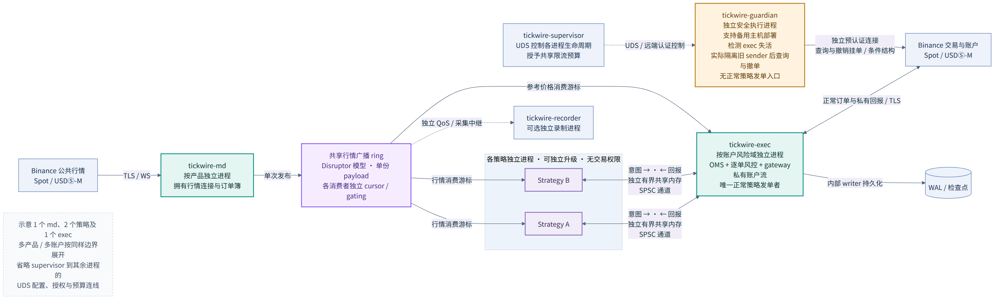
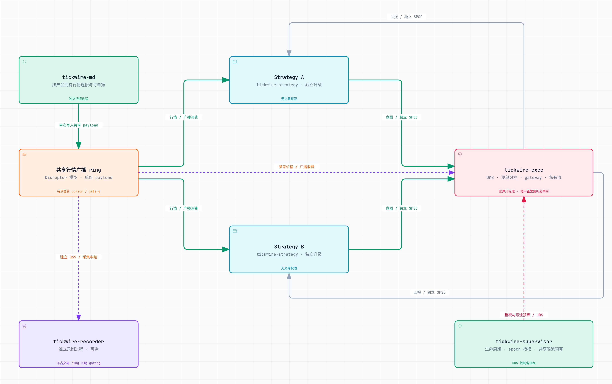
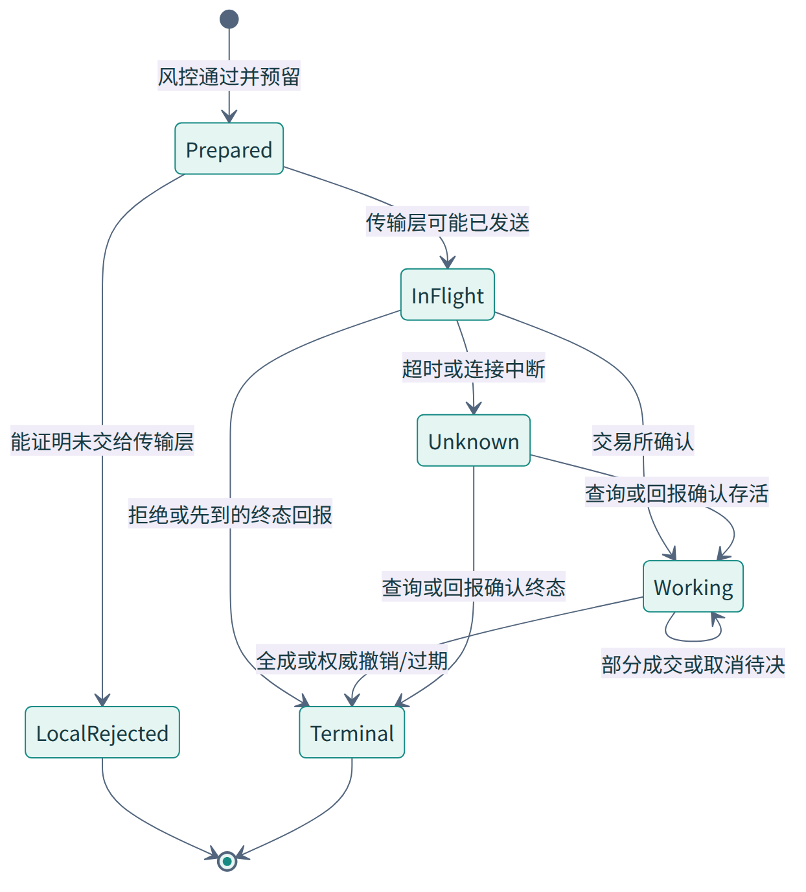
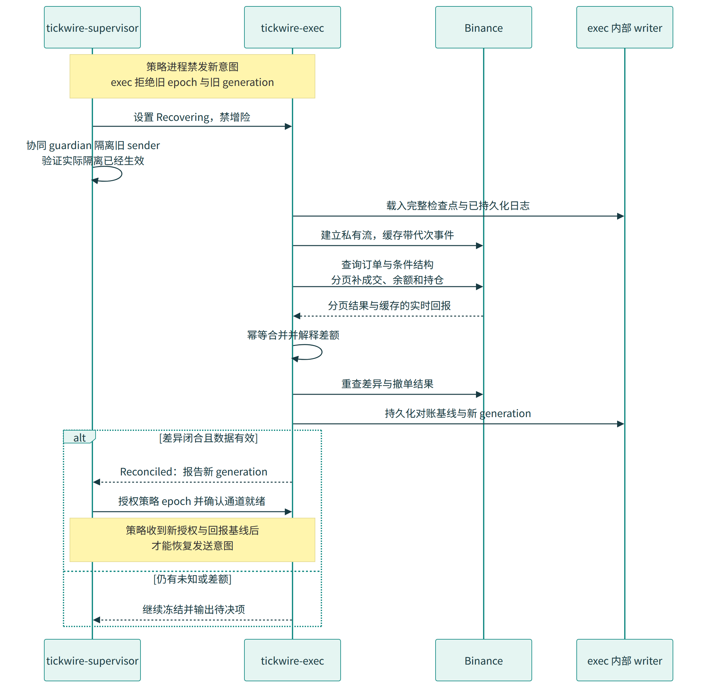
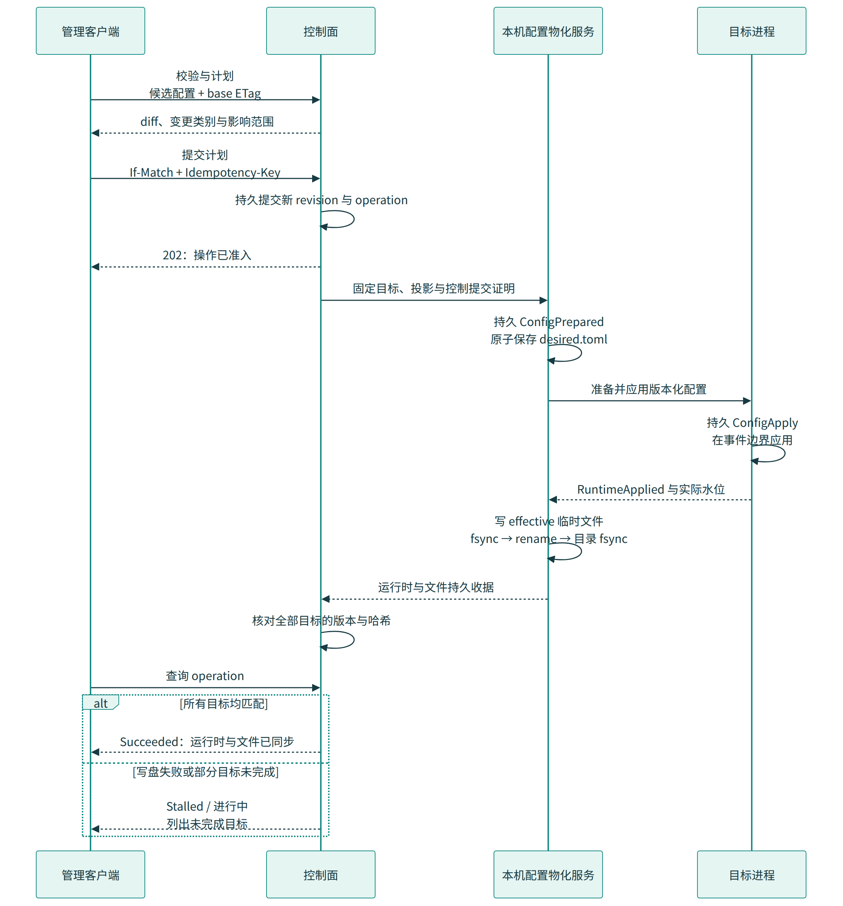

# Tickwire：Binance 现货与合约生产交易系统设计

版本：v0.3 · 2026-10-20 · 状态：生产详细设计基线，待实现与资格验证

Tickwire 使用 Rust，对接 Binance Spot 与 USDⓈ-M 合约。运行架构采用**独立行情进程、每策略实例独立进程、按账户风险域独立的执行进程，以及控制监督和紧急执行进程**。策略可以独立新增、升级、回滚和退出，执行进程中的 OMS、资金预留和交易所会话持续运行。

热数据面使用共享内存。行情采用 **Disruptor 式多消费者共享广播 ring**，一份事件供多个策略和执行风控消费；策略意图与执行回报使用独立有界通道。控制面管理资源、版本、授权和部署，正常逐笔交易不经过控制面的请求往返。

设计按真实上线要求展开，不用原型范围或较少进程数替代发布、隔离、恢复与验证能力。当前已开始 Rust 核心库与 MockService 实现，进度见[实现规格](../../specs/20261020-implementation.md)；本设计的性能数字仍是完整生产链路的资格目标。

## 1. 设计结论与评审入口

| 决策 | 选择 | 直接原因 |
|---|---|---|
| 产品 | Spot 与 USDⓈ-M 同时覆盖 | 两套协议、资金语义与故障恢复分别验收 |
| 进程隔离 | 行情、各策略实例、各执行风险域、supervisor、guardian 分开 | 策略发布或崩溃不终止 OMS 与订单连接 |
| 行情通信 | 每 topic/QoS 的共享广播 ring、独立消费与释放游标、依赖屏障 | 多策略读取同一份数据，保留顺序与完整性 |
| 慢消费者 | 有证据的摘除，预分配 ring bank 冻结/切换，受控回收 | 不覆盖仍可能被访问的槽位，也不无界堆积内存 |
| 执行状态 | OMS、逐单风控、预留与 gateway 在同一执行所有者内 | 检查、预留和提交保持一致；策略不能自行绕过风控 |
| 策略发布 | Shadow 预热、状态与事件水位衔接、执行侧授权代次切换 | 独立发布时保留已有订单和持仓，不隐式重发 |
| 故障保护 | exec 维持策略失联后的订单；guardian 处理 exec 故障后的查询/撤单 | 不依赖已经卡死的策略或执行循环自行处理 kill 标志 |
| 持久化与HA | 默认本地持久意图＋后台异步复制；Raft只用于控制面 | 正常订单不等待远端确认；副本缺尾部时不冒充无损接管 |
| 性能 | 同时测共享内存、策略、执行、持久化和实际发送总延迟 | 不用内部微基准替代完整生产链路 |
| 正确性 | 单元/性质测试、真实多进程集成、源码对应的 vibe-tla/TLC | 分别验证计算、协议/内存行为与故障交错 |
| 配置 | 文件与控制API走统一版本发布；本地desired/effective文件持久刷新 | 运行时和目标文件均到达同一revision/hash才宣布成功 |

建议结合阅读：第 4 节进程与多策略、[共享内存 IPC 契约](shared-memory-ipc.md)、[策略生命周期](strategy-lifecycle.md)、第 7～9 节订单/恢复，以及第 12～14 节性能与上线门禁。

详细设计的规范入口：

| 主题 | 已确定的可实现契约 |
|---|---|
| [IPC二进制接口](ipc-abi.md) | 字段类型/offset/size、消息ID、错误码、控制响应、快照清单和编码向量 |
| [风控计算](risk-calculations.md) | 单位、公式、舍入、账户覆盖票据、压力资本与合成数值向量 |
| [日志复制与主备](replication-and-failover.md) | 默认异步数据复制、低频控制Raft、WAL布局、水位/完整前缀证明和实际隔离 |
| [参考部署与SLO](deployment-and-slo.md) | 两交易主机＋控制第三节点，容量、超时、300µs/1ms完整路径参考目标 |
| [配置文件与控制接口](configuration.md) | 配置schema、变更分类、校验/计划/发布/回滚、运行时与本地文件一致性 |

机器契约与样例在 `specs/contracts/` 和 `config/`；设计验证脚本只检查这些文件，不等同于交易引擎运行测试。

### 1.1 产品与能力边界

- Spot 维护资产、冻结、订单及订单列表、成交和费用；USDⓈ-M 维护持仓、保证金、标记价格、资金费率、强平/自动减仓与算法条件单。
- 网关以类型化命令覆盖对应产品支持的限价、市价、IOC/FOK、只挂单、撤单、查询、撤改及条件结构。Spot 的 STOP/OCO/OTO/OTOCO 与 Futures 的 algo 订单使用不同状态机，不能把未触发子单遗漏在风险之外。
- USDⓈ-M 的单向/双向持仓、全仓/逐仓、单资产/多资产保证金分别有显式模型与资格测试。账户配置与部署清单不匹配时拒绝激活，不通过自动改仓位模式或杠杆让检查“通过”。
- 具体标的由元数据和部署清单选择；永续处理资金费率，交割合约处理到期、结算和换月。COIN-M、期权与 Portfolio Margin 是不同产品/风险域，不能假装由相近字段自动获得支持；CM/UM 已共享的账户配置和限额仍必须识别。
- 支持多策略共用账户，统一维护每策略归属与账户总风险。严格风险模式要求所有主动资金使用经过同一账户 exec 的预留入口，或处于交易所真实隔离的子账户/预算域；手工/API 客户端也需受该入口管理。不可控外部写入只能观察和对账，不能与严格放行保证混用。
- 回测与模拟器用于验证和策略研究，不构成线上成交概率或收益证明。生产上线必须覆盖进程隔离、独立发布、紧急撤单、接管和回滚。

## 2. 依据与证据边界

专项调研保存原始来源、源码定位和取舍；其中早期记录中的部署建议由本版生产设计取代：

| 材料 | 在本设计中的作用 |
|---|---|
| [本地技术文章提炼](../research/local-notes.md) | 延迟测量、内存与线程模型、部署、时钟、网络、回测，以及分布式账户方案的适用边界 |
| [Binance 官方协议调研](../research/binance-protocols.md) | 产品能力、端点、编码、认证、订单语义、行情同步、限流与恢复 |
| [开源系统与 Rust 组件调研](../research/opensource-rust.md) | 固定提交上的运行结构、代表性源码、许可证和组件选择 |
| [共享内存与广播组件调研](../research/shared-memory-ipc.md) | Disruptor、iceoryx2、跨进程生命周期、版本和权限的实际保证 |

本地文章中的 C++ 微基准、外部项目成绩和账户服务的毫秒级指标不会转写为 Tickwire 的 Rust 实测。源文档的事实、从事实推导的架构选择、待验证性能目标分别表述。币安协议和开源依赖以实现时锁定的版本为准；调研中的固定 commit 用来重现本版设计依据。

## 3. 交易所接入：先按产品拆语义

简单二进制编码（Simple Binary Encoding，SBE）用固定 schema 编解码报文；金融信息交换协议（Financial Information eXchange，FIX）还规定交易消息与会话语义。SBE 行情、REST/WS API 的 SBE 响应、FIX 的 SBE 会话是不同接口，不能共用一个“开启 SBE”配置。

### 3.1 能力矩阵与主备协议

| 能力 | Spot | USDⓈ-M | Tickwire 选择 |
|---|---|---|---|
| 市场行情 | JSON WS、SBE WS；FIX 行情接口另行接入 | JSON WS；按流类别使用 `/public`、`/market` | Spot 实现 SBE 与 JSON 两个解码器；合约实现独立 JSON 解码器 |
| 下单/撤单 | REST、WS API、FIX；当前 FIX 支持双向 SBE | REST、WS API；条件单有独立 algo API | WS API 提供两产品基线；Spot FIX SBE 作为性能候选并通过同样验收 |
| 快照与元数据 | REST depth、exchangeInfo 等 | REST depth、exchangeInfo、账户/持仓/风险档位等 | 由控制面请求，经版本化事件导入状态所有者 |
| 私有回报 | 订单通道回报 + User Data；Drop Copy 可补充 | `/private` 用户数据流与交易请求响应 | 两边都独立建立账户事实通道；流中断立即限制增险 |
| 重建订单状态 | 查询订单、未成交订单、成交历史、余额 | 查询订单、未成交订单、成交/收入、账户与持仓；包含 algo 域 | 做交叉核对，单次“查不到”不等于交易所未执行 |
| 测试环境 | Spot Testnet；schema 可能与生产不同 | Futures Demo/Testnet，按官方环境端点配置 | 测试认证、协议和恢复；不把测试网延迟当生产延迟 |

当前官方现货 FIX 文档提供传统端口与 SBE 双向端口，Drop Copy 明示有 1 秒延迟。因此，Drop Copy 用于补账和核查，热路径采用订单连接的执行回报和账户流。[现货 FIX 文档](https://developers.binance.com/docs/binance-spot-api-docs/fix-api)

合约 WebSocket 已按 `/public`、`/market`、`/private` 划分；depth/bookTicker、markPrice/资金费率和私有流必须接到正确的类别。行情启动验收要收到所需类别的样本并验证新鲜度；私有流通过认证/订阅确认、listenKey 有效期、心跳与账户快照基线建立健康状态，不要求安静账户必须先发生一次成交。不能只检查 HTTP 升级成功。[合约 WebSocket 迁移公告](https://developers.binance.com/en/docs/products/derivatives-trading-usds-futures/websocket-market-streams/Important-WebSocket-Change-Notice)

### 3.2 会话、认证与限流

`SessionConfig` 包含产品、环境、端点、协议版本、认证方式、密钥引用、心跳/续期/轮换时间、请求有效窗口和限流能力。实现前根据[协议调研](../research/binance-protocols.md)中的官方参数建立 fixtures，禁止把现货参数复制到合约配置中。

- 现货 FIX、SBE WS 行情及支持的 WS 会话认证的 Ed25519 要求、API 权限与产品可用性分别预检；普通 API 选择 SBE 响应不代表所有接口都采用相同的密钥类型要求。密钥来自运行时凭据存储，只在签名边界可见，配置与日志保存引用，不保存明文。
- 请求签名、时间戳和 `recvWindow` 按具体接口生成。校时失效或偏移超过配置阈值时禁止增险；不能通过无限扩大接收窗口掩盖时钟故障。
- 每个连接实现心跳、超时、主动轮换、重连退避和重订阅。IP 连接数、控制消息、请求权重、订单数等限额是不同维度，分别记账。Futures 的 CM/UM 共享持仓模式及部分 IP/账户订单额度，统一分配这些预算；同一 IP 的多个账户也不能各自占用整份 IP 限额。详见[CM/UM 整合与限流依据](../research/binance-protocols.md)。
- 限流器以交易所返回和 exchangeInfo 等适用的权威配置为准。为撤单、查询和恢复预留容量；429/418 或产品特定限流状态触发冷却。超时的尝试仍保守计入本地已使用额度。
- 网关切换只迁移**后续新意图**。旧会话中结果未知的订单不经备用协议重发；同一账户同时有多个交易连接时，共用订单 ID 分配器和账户级限流所有者。
- FIX 会话序号、重连恢复和业务重发遵守币安实现的支持范围，不自行套用通用 FIX 引擎的 resend 行为；重复或延迟执行报告必须经过订单层去重。

### 3.3 Schema 生命周期

协议 schema 进入版本库，记录来源 URL、commit、内容 SHA-256、生成器版本、环境及测试向量。生产和测试网可处于不同版本，官方 `latest` 指针也可能与生命周期记录不一致，必须使用显式文件与会话返回验证版本。未知模板、短包、块长度不合法或不受支持的版本触发连接/产品降级，不能按旧布局继续读字节。

统一事件必须保留交易所原始序号、事件/成交时间、连接代次、产品、schema 版本与本机接收时间，不能只留下价格和数量。归一化用于共享业务逻辑，原始字段用于追查异常与恢复。

## 4. 进程、线程、多策略与状态所有权

### 4.1 进程职责与故障范围



[进程图源](../assets/process-topology.mmd)。图按实例类型展示；行情按产品/分片、策略按实例、执行按账户风险域横向扩展，控制线不表示每笔订单需要控制面批准。

| 进程 | 独占状态与职责 | 发布或故障时的边界 |
|---|---|---|
| `tickwire-md` | 交易所公共行情连接、解码、序号同步、规范化订单簿、topic 发布与不可变快照 | 单个行情分片重建不重启策略/exec；受影响订阅进入失效或按新代次重同步 |
| `tickwire-strategy` | 一个逻辑策略的一个运行实例；信号、策略局部状态、输入水位、检查点 | 独立二进制和配置，可与其他策略及自己的 Shadow 同时运行；无正常下单凭证 |
| `tickwire-exec` | 一个账户风险域的 OMS、资金预留、持仓归属、逐单风控、正常交易网关、私有回报与恢复 | 不随策略升级重启；策略退出后继续处理其订单、成交和撤单；一个域的故障不直接破坏另一域的内存 |
| `tickwire-supervisor` | 部署与期望状态、进程身份、SHM 资源、策略发布操作、控制租约、共享 IP/UID 限流授权 | 不转发正常逐笔订单；重启后按持久控制日志和各 exec 的实际 applied 状态重建，不能恢复旧授权 |
| `tickwire-guardian` | 独立紧急查询/撤单连接、exec 失活处置、条件结构和子单核查 | exec 失效时仍可工作；先确认旧发送者隔离，再接管应急操作；无正常策略交易入口 |
| `tickwire-recorder` | 经授权的行情与诊断采集、压缩、归档和研究索引 | 独立 QoS/中继，不把磁盘停顿传播到交易广播 ring；缺口显式记录 |
| `tickwire-replay` | 离线运行同一领域核心，驱动模拟交易所和虚拟时间 | 不持有生产执行凭证，不参与生产 owner 选举 |

每个进程具有独立 CPU/内存/SHM/文件描述符预算和操作系统身份约束。直接 SHM 接入的策略必须通过受审计 SDK 的发布/释放契约；不受信任的 native 策略通过独立适配进程与内核消息边界隔离，额外开销单独计量。进程隔离不消除同机内存带宽、磁盘、NIC 和主机故障，因此生产部署另外设置主备主机与实际隔离机制。

一个执行域键为 `(venue, account/subaccount, product, margin_domain)`。共享现货资产或共享全仓保证金的订单归同一 exec 所有者，不能按交易对任意拆开后重复使用余额。OMS、逐单风控和 gateway 保留在同一个执行进程中；它们是稳定执行基础设施，策略代码不加载进该进程。

### 4.2 共享内存数据面与控制面



[交互式架构图](../assets/tickwire-architecture.html) · [详细 IPC 契约](shared-memory-ipc.md)。同一 topic 的广播记录只存一份，消费者的游标与释放水位独立。

| 方向 | 通道与内容 | 可靠性与权限 |
|---|---|---|
| md → 各 strategy / exec 风控 | Disruptor 式共享广播 ring；行情事件、簿版本、来源序号 | 每个消费者读到订阅事件；严格 gating 防覆盖，exec 不依赖策略转述的价格 |
| strategy → 对应 exec | 每实例/风险域独立 SHM SPSC，传有身份、期限和因果水位的订单意图 | 传输提交不等于业务接受；exec 统一去重、风控、预留、日志与发送 |
| exec → 各 strategy | 每实例独立 SHM 回报通道 | 订单/成交与授权状态带报告序号；策略失联不影响 exec 入账，重连后快照加回放 |
| supervisor ↔ 各进程 | Unix Domain Socket；远端控制使用相互认证连接 | SCM_RIGHTS 交付本机资源；request ID、版本、代次及 received/applied ACK 明确分开 |
| md / exec → recorder | 独立 QoS topic 或受控采集中继 | 不占用交易消费者的无界保留时间；丢样不能伪称完整数据 |
| exec ↔ Binance | 产品对应的 TLS/WS/FIX 与私有流；REST 查询由 exec 服务线程执行 | 只有 exec 的正常交易路径能把策略意图提交交易所 |
| guardian ↔ Binance | 独立认证的查询和应急撤单会话 | 正常状态不竞争执行所有权；不假定交易所提供专门的 cancel-only API key 权限 |

共享内存使用固定 wire ABI、相对偏移和预分配内存，控制面创建并验证资源，正常逐笔通信不调用 socket 转发。Unix socket 仍承担资源协商和操作指令，不将所有控制消息也塞进同一个数据 ring。

### 4.3 多消费者与慢策略隔离

每个行情 topic 有独立 `topic_seq`，每个消费者维护 `read_seq` 与连续 `released_seq`；只有后者允许生产者复用内存。一个策略内部仍持有 payload 引用时，不能因主线程已经读取或已收到停机命令而提前释放。

活跃消费者通过 gating 保护槽位。慢消费者由执行侧撤销增险授权，再按 quiesce ACK 或真实进程退出证明摘除。为避免坏策略长期阻塞健康策略，发布者在高水位前将旧 bank 冻结在完整序号 S，健康读者读完 S 后迁移到从 S+1 发布的新 bank。旧 bank 保持不变，直到引用释放；预分配 banks 耗尽时只使相关 topic/QoS 失效，不能覆盖旧槽位或无限申请内存。

依赖型策略可配置消费者屏障，例如特征计算已覆盖行情至 S 才允许使用该特征。独立策略不互相等待；依赖图必须无环，特征输出放在自己的不可变事件流中，不让消费者共同改写已发布行情。

`ring_epoch`、`feed_generation`、`strategy_generation` 和 `exec_generation` 分别表示内存资源、行情连续性、策略授权实例和执行实例。兼容的 ring 轮换不自动改变行情连续性；策略升级也不要求所有策略共用的行情 ring 重建。

### 4.4 多策略公平调度与账户风险

每个策略实例都有独立的意图/回报通道、订阅、CPU 和借用配额。exec 按有界公平预算轮询各意图队列，给私有成交、撤单和风控控制留处理机会。策略不能通过填满一个共享 MPSC 队列压住其他策略，也不能直接修改账户订单与预留。

`logical_strategy_id` 是持久归属，`instance_id/generation` 是某次运行与授权。订单、成交、虚拟持仓和费用按逻辑策略归属，exec 同时维护交易所账户总量；账户净仓与策略各自仓位是不同视图。必须满足“各策略归属 + 外部/未分配归属 = 账户事实”的对账关系，并分别限制每策略毛敞口和账户净风险。

多策略共用现货资产或合约保证金时，exec 原子执行账户总限额、策略限额和预留。内部转移归属不释放实际资金；资金费、手续费、外部订单和划转按明确规则分摊或留在未分配科目。手工订单/其他机器人若接入生产交易，必须作为受控逻辑来源经过 exec，或使用实际隔离的账户资金；只订阅它们事后产生的回报无法防止同时花同一份余额。发现绕过入口的主动资金变动时进入 `ExternallyMutated`、停止增险并对账，不继续宣称本地原子预留覆盖了这些写入。账户划转采用独立管理操作，在 owner 处预留来源扣款并核实目标入账，不以发布操作隐含授权。自成交防护覆盖同账户不同策略，按产品支持的 STP 模式与中央订单视图执行，不能只依赖单策略自查。

共享 IP、UID 与接口重叠限流由 supervisor 的配额协调器预授互不重叠的窗口额度，包含 `bucket/window/generation/grant_id/expiry`。exec 逐笔只消耗本地授权，不等控制面往返；过期/失联授权不续用，未确认停止消费的额度不提前重授。风险资金预留仍由账户 exec 管理，不移到 supervisor。

### 4.5 策略独立发布与接管

生产发布采用稳定逻辑策略 ID、新运行代次和 Shadow 预热。Shadow 可以订阅行情和回放事实，但 exec 没有给它增险权限。兼容升级支持原位移交：exec 撤销旧代次、确定未发送意图的终止/接管选择，发布订单/持仓/预留的一致视图；新策略载入版本化检查点并追平事件后，exec 在持久化的交接状态下切换授权。

已有交易所订单和持仓仍在 exec 中，不因策略二进制替换而取消或重建。`MayHaveSent/Unknown` 保留原 ID、订单事实和预留；回滚也分配新的授权代次，不重新启用一个可能还在发送旧意图的代次。不兼容的状态迁移采用显式撤单/退出策略，不把未解决敞口当成空仓。

跨现货/合约、多个 exec 的策略发布使用持久 operation 状态、所有参与域准备确认和增险闸门；管理权切换与恢复增险分开。交易所两腿没有全局原子提交，必须处理部分激活和单腿执行失败。完整状态机、迁移证据及图见[策略生命周期](strategy-lifecycle.md)。

### 4.6 热循环与线程分工

每个 md 分片拥有自己的行情连接、订单簿和广播发布线程；每个策略进程拥有自己的消费/计算循环；每个 exec 风险域有唯一订单/风险写入线程。各进程的服务线程处理控制协议、连接准备与慢查询，writer/复制线程推进持久化水位。

```text
md：socket → 解密/解帧 → 解码/连续性校验 → book 更新 → 广播发布
strategy：acquire 行情 → 策略计算 → 发布意图 → 释放行情引用
exec：读取意图 → 身份/代次/期限 → 账户及策略风控 → 预留与订单状态
      → 本地持久化意图（显式同步提交模式另等镜像） → 最终发送门禁 → 编码/签名 → socket
exec：私有回报 → 幂等更新订单/账户 → 持久事件流 → 策略回报
```

本地持久化、socket 不可写或配额不足时，意图留在有界 pending 状态，exec 不阻塞等待。最终发送前重新检查策略/执行授权、控制租约、行情与账户有效性、配置和意图期限。策略卡死不会阻止 exec 执行这一步；exec 自身卡死由独立 guardian 和实际隔离流程处置。

## 5. Rust 模块与数据布局

计划中的 Cargo workspace 按领域、协议和运行边界拆分；共享领域库不等于共享进程。

```text
crates/
  domain/               # 定点类型、产品、订单、持仓、归属与领域事件
  market/               # 连接、归一化、簿同步与不可变快照
  strategy-api/         # 版本化策略接口、检查点、订阅与意图类型
  execution/            # 单写 OMS、授权表、策略归属与订单路由
  risk/                 # 账户/策略限额、资产预留、保证金和 STP
  binance-spot/         # 现货行情、交易、账户与 orderList
  binance-usdm/         # 合约行情、交易、账户、algo 与仓位模式
  transport/            # TCP/TLS/WS/FIX framing 与发送进度
  ipc-abi/              # 跨进程固定布局、版本与消息校验
  ipc-shm/              # 映射、广播 ring、SPSC、gating、bank 与回收
  lifecycle/            # 发布、授权、交接、回滚和控制操作日志
  journal/              # WAL、提交/复制水位、检查点与回放
  reconcile/            # 订单/成交/资金/持仓及策略归属对账
  guardian/             # 独立应急查询、撤单与隔离协调
bins/
  tickwire-md/
  tickwire-strategy/     # 各策略可独立构建为兼容 ABI 的二进制
  tickwire-exec/
  tickwire-supervisor/
  tickwire-guardian/
  tickwire-recorder/
  tickwire-replay/
```

领域层以 `apply(state, event, actions)` 更新本地状态，网络、时钟和磁盘结果通过显式事件输入。进程间传固定 wire 数据，不能把 Rust 指针、引用、`Vec/String` 或 trait object 直接放入共享内存。[IPC ABI](ipc-abi.md)给出精确布局和编解码向量；实现必须按其消息类型和有效位解释数据，不能自行猜字段。

价格/数量使用 `PriceTicks`、`QtyLots` 定点整数，金额与乘法中间值用检查溢出的 `i128`；元数据定义步长、合约乘数、费用资产、过滤器、保证金模型和舍入规则。不用浮点误差判断交易所步长是否合法。

启动期建立整数 instrument/strategy/account ID、预分配订单槽、队列、ring banks、payload arena 和快照预算。容量耗尽进入明确状态，不能热路径无限扩容；订单簿价格窗口外数据需要可验证的稀疏区或重建，不能静默丢弃。

`unsafe` 限定在可审计的映射/布局/原子视图中，业务状态使用安全 Rust。零分配目标分别覆盖发布、策略计算、执行 reducer 和编码；TLS、连接建立、快照、发布切换和故障路径独立计数。共享内存的别名和生命周期由 [IPC 契约](shared-memory-ipc.md)约束，Miri/loom 与真实多进程测试共同提供证据。

## 6. 行情与订单簿

### 6.1 Spot JSON 深度同步

按官方流程先建立增量订阅并缓存，再获取 REST 快照。令快照最后更新号为 `L`，增量事件覆盖 `[U, u]`：

1. 若快照 `L` 早于缓存首事件的 `U`，重新请求快照；丢弃 `u <= L` 的过期事件。
2. 首个可应用事件必须满足 `U <= L + 1 <= u`，即覆盖快照后的下一次更新。
3. 应用买卖价格层的**绝对数量**；数量为零删除该价格层。将本地更新号置为 `u`。
4. 后续事件若 `u <= local_id` 则忽略；若 `U > local_id + 1` 则存在缺口，book 进入 `Invalid` 并重建。

快照有深度上限，未覆盖的远端价格层是“未知”而非零。策略可查询的深度、可接受的 book age 与完整性必须明确。[现货本地订单簿维护规则](https://developers.binance.com/docs/binance-spot-api-docs/web-socket-streams#how-to-manage-a-local-order-book-correctly)

### 6.2 Futures JSON 深度同步

合约的桥接规则与 Spot 不同：丢弃 `u < L` 的事件，首个事件要求 `U <= L <= u`，随后每个事件的 `pu` 必须等于前一个已应用事件的 `u`。不连续就重新同步。两套同步器共享缓存设施，但不共享错误的边界谓词。[合约本地订单簿维护规则](https://developers.binance.com/docs/derivatives/usds-margined-futures/websocket-market-streams/How-to-manage-a-local-order-book-correctly)

Spot SBE WS 官方文档指向同一套 Spot 同步规则，按其 schema 映射序号字段并用独立 fixture 验证。Spot 初始化文字中“首事件包含 L”与应用规则允许 `U=L+1` 存在边界文案差异；本设计采用覆盖下一更新 ID 的判定，用 `U=L`、`U=L+1`、`U=L+2`、`u=L` 的录包与模拟用例固定行为，详见[协议调研第 4 节](../research/binance-protocols.md)。FIX 行情则维护独立同步器：FIX 会话序号不是订单簿更新号，FIX SBE 的删除标记是 `MDEntrySize=NullVal`，不能套用 WS 的数量零规则。

### 6.3 新鲜度、切换与跨产品策略

book 状态为 `Bootstrapping → Live → Invalid/Resyncing`。只有 Live 且数据、连接与账户状态满足策略阈值、Futures 另有有效 markPrice 时，才允许新增风险。收到 TCP 字节或心跳不等于价格数据仍在更新；无成交的合法静默与数据源故障通过订阅健康和数据类型的预期更新方式区分。

轮换连接时为新流创建独立 `generation` 和 shadow book。它完成快照桥接后，由所有者在一个事件边界切换；来自旧 generation 的迟到事件全部隔离。不同端点的行情不可在没有共同序号依据时混合拼接。

跨现货/合约的基差或对冲策略接收带时间与版本的两域快照，检查双方新鲜度和最大观测偏差。两腿是独立订单：设最大未对冲数量、持续时间、滑点与撤退策略；任一腿拒绝/未知时，另一腿的风险预留继续存在，进入受限的补偿处理。

## 7. 订单、预留与账户状态

### 7.1 三类状态分开保存

订单业务状态、请求发送状态、取消尝试状态分别保存。`CancelPending` 不表示订单已撤销，`Unknown` 也不等于交易所拒绝。执行回报可能早于请求 ACK 到达；后来的 ACK 不得把已成交订单倒退成新单。



[可编辑图源](../assets/order-state.mmd) · [矢量图](../assets/order-state.svg)

图展示提交与订单生命周期的主要组合；实际数据中取消尝试是正交字段，终态后的迟到成交与手续费补充仍需入账，不因图中的终态箭头而忽略。

### 7.2 必须成立的不变量

| ID | 契约 |
|---|---|
| INV-1 额度守恒 | 每次主动增险前，预算必须覆盖组合后的敞口与活动/未决预留；外部价格、费用或清算变化造成不足时记录真实缺口并禁增险，不伪造仍然充足的额度 |
| INV-2 未知不释放 | 可能已发送且没有权威结果的意图保持占额；计时器不产生释放动作 |
| INV-3 成交单次入账 | 相同账户、产品、标的、订单与成交标识的事件最多改变一次经济状态；重复报文允许更新非经济元数据 |
| INV-4 数量单调 | 累计成交量不因迟到 ACK/快照下降；终态不被旧活动状态覆盖；交易所明确更正通过独立调整事件入账 |
| INV-5 行情有效 | 新增风险要求有效且足够新的行情和账户状态；增量缺口或私有流故障后禁开仓 |
| INV-6 单一发送者 | 一个风险域在任一时刻最多有一个获得实际执行权的所有者；本地 epoch 不能代替隔离 |
| INV-7 恢复屏障 | 崩溃/私有流缺口后的增险发送只能发生在对账完成且旧发送者已隔离之后 |
| INV-8 配置一致 | 一次策略决策与风险判断绑定相同的 instrument/risk 配置版本；失效版本不能继续下单 |
| INV-9 产品隔离 | Spot 余额与 Futures 保证金不互相借用，划转完成前不增加接收域可用额度 |
| INV-10 减仓真实性 | 被允许通过停机状态的动作必须按当前仓位模式与未决订单证明不增加最大敞口，不能仅信任调用者的 reduce 标签 |
| INV-11 广播内存安全 | 任一消费者仍可能访问的槽位/payload 不被覆盖或复用；摘除和回收有 quiesce/退出证据 |
| INV-12 独立策略授权 | 只有 exec 已授权的策略代次能产生新的外部动作；Shadow、旧代次和跨域未放行状态不能越权 |
| INV-13 交接守恒 | 策略升级/回滚不复制订单、不释放未知预留、不重复归属持仓，已发送意图不重发 |
| INV-14 广播连续性 | bank 轮换保持 S→S+1 或显式重同步；ABI/代次不匹配的数据不可用于交易 |

### 7.3 风控与预留的具体含义

完整公式、精确舍入和可复算案例以[风控计算契约](risk-calculations.md)为准。这里概述状态所有权；不以概述替代金额计算。主动吃单区分有价格界的 `BoundedTaker`（编码为IOC限价）与原生MARKET，不静默改订单语义；无法界定增险支出/持仓的原生市价意图按明确错误拒绝。

Spot 买单预留最大报价资产支出与手续费缓冲，卖单预留基础资产；允许多资产收手续费时单独处理。部分成交把对应预留转换成真实现金流，剩余数量继续占额。撤销确认后只释放未成交部分，手续费补账有独立缓冲。余额快照里的 free/locked 与本地预留必须使用明确的对账基线，禁止把同一笔交易所冻结资金再减两次。

本地分开保存 `EconomicLedger`（成交、手续费、资金费和划转事实）与 `VenueObservation`（账户推送/查询快照）。成交只在账本应用一次，账户快照不再次产生同额现金流；它用于核对一个已经解释清楚的基线。日常额度按该基线及基线后账本、活动预留推导，不能在每条余额推送时覆盖账本。若无法证明某次快照是否包含一笔成交，立即限制该风险域增险并保守占额；旧快照不得增加可用额度。只有第 8 节的对账流程解释完覆盖关系后，才原子发布新基线、对应的账本偏移与剩余预留。

CM/UM 整合后的行情/私有消息必须根据 `st`、产品元数据与 `ps` 等字段识别归属，不能由连接域名直接判成 UM。若发现本风险域未纳入的 CM 仓位/订单或无法确认共享账户状态，拒绝激活该衍生品风险域。

Futures 的本地保证金检查以仓位模式、全仓/逐仓、标记价格、杠杆与风险档位为输入，使用保守的组合后敞口计算。计入当前持仓、所有可能成交的未决订单、最坏并发成交、手续费、资金费率和价格压力缓冲；限额不得高于经新鲜度检查的交易所可用余额。对冲腿没有成交前，不能把预期对冲收益抵扣另一腿保证金。

多资产保证金另维护各抵押资产的估值、折扣与转换规则，结合交易所账户可用余额作保守检查；缺少有效价格或抵押资格时不得把整份资产余额计入保证金。单向仓按净仓核算；双向仓的 LONG/SHORT 持仓与 `positionSide` 必须独立处理。单向仓减仓使用 `positionSide=BOTH` 与 `reduceOnly=true`；双向仓平多使用 `SELL + LONG`，平空使用 `BUY + SHORT`，不得发送 `reduceOnly`。可减数量还要扣除可能成交的未决减仓单；仓位模式不匹配或资格验证未通过时拒绝激活。产品适配器对这些组合逐项校验。资金费率入账、强平和自动减仓属于交易所事实事件，可能在没有本地订单意图时改变账户状态，需要更新账本并触发风险重估。不得以本地公式自称精确预测交易所清算价。

### 7.4 ID、幂等与撤改

- `clientOrderId` 在本系统的账户/产品命名空间内永久不复用；通过持久化启动代次和预分配序号区间生成，满足各协议长度/字符限制。交易所可能允许某些终态 ID 再用，本系统仍不利用这一点。
- 传输请求 ID 只用于请求与响应关联。提交超时后保留原意图、原 ID、预留与原始发送进度，查询和流回报并行对账，不自动用新 ID 再发。
- 发送进度区分 `NotSubmitted`、`MayHaveSent`、`Confirmed`；只有能证明没有交给任何可能输出的 TLS/socket 缓冲时，才走本地失败释放。部分写、TLS 已接受明文、对端读到但 ACK 丢失，都进入可能已发送。
- Spot cancel-replace 分别记录撤旧与新单的成功/失败，按最坏并存处理预留；Spot amend keep priority 是原单减量，按成功后的剩余量更新预留；Futures modify 会重新排队，`newQty <= executedQty` 或 GTX 改价将立即成交等条件还可能取消原单。三者分别建模，不把 amend/modify 都包装成撤旧下新；未知结果继续按原单与请求后可能状态保守占额。
- 合约 algo 条件单的 `algoId`、触发后 `orderId` 与常规订单 ID 分开建关联。系统拒绝无条件接管任何不在部署支持集合内的存活条件结构：启动/恢复时查询 open algo orders 和 Spot `/api/v3/openOrderList`，运行时持续处理 `ALGO_UPDATE`、`listStatus` 及普通订单回报。发现陌生结构就禁止增险，父单与已触发子单分别查询、受控撤销并对账；父 algo 消失、`TRIGGERED/FINISHED` 或 Spot working leg 结束，都不能直接释放 pending/子单敞口。清理结果闭合后才允许恢复。

所有生产路径经过最终发送入口，但授权前提按动作类别区分：

| 授权类别 | 可执行动作 | 必要前提 |
|---|---|---|
| `StrategyGrant` | 策略新单、撤改与批准的业务动作 | 当前逻辑策略/实例/代次及订单管理权有效；新增风险还需行情、账户、配置、额度与恢复证据有效 |
| `ExecutorRiskAction` | exec 自主撤单、处理失联策略、批准的风险收缩 | 绑定 exec 身份、事件/政策版本和处置范围，不要求已经撤销的策略授权仍有效；真实减仓仍要证明不会扩大风险 |
| `GuardianEmergencyGrant` | 独立查询、应急取消与获准的正式处置 | 绑定事件/操作、账户、权限与隔离状态；未隔离的尽力取消不产生 Safe 或新主授权 |

每次 `NotSubmitted → MayHaveSent` 前，按动作检查运行状态、实际 owner、相应授权、控制/处置租约、恢复代次、期限、限流与相关订单版本。新增订单/增险改单还必须验证资金预留、数据有效性和提交水位；撤单不会因为被撤策略已无授权、行情断流或账户快照陈旧而一律禁发。因不可写而等待的旧报文也必须重过门禁；未通过时只撤销尚未交给传输层的缓冲并按本地失败处理。跨过边界后，即使 kill 或行情故障到来，也不能释放预留后让旧 TLS/socket 缓冲继续输出，应保留 Unknown 并对账。

## 8. 日志、复制与恢复

### 8.1 默认本地提交，复制不进入逐单路径

默认提交模式固定为 `LocalDurable+AsyncReplica`：单写 exec 将新单/增险改单的意图、授权、预留和完整恢复依赖在本地可靠存储同步后，才返回 Accepted 并允许首次可能发送。后台异步复制到另一交易主机；数据域不运行Raft，控制面共识不参与逐单确认。具体帧格式、合批、水位与恢复算法见[复制与主备详细设计](replication-and-failover.md)。

| 提交模式 | 发送条件 | 故障范围 |
|---|---|---|
| 默认LocalDurable+AsyncReplica | 本地完整封口批次与RecoveryManifest闭包已持久化并应用 | 原本地可靠存储可读取时可恢复；异步备机可能缺尾部，不承诺原盘永久丢失后的零丢失/自动恢复 |
| 显式SyncReplica | 默认条件，加指定镜像对相同前缀和完整闭包的持久ACK | 为明确的跨机零丢失要求选择；网络/镜像flush计入延迟，镜像失败不自动降级异步 |

Raft只负责低频配置、发布和拟执行权，固定三有状态控制voter、2/3多数；它的任期不能隔离Binance旧发送者。正常逐单只检查已经应用的本地授权。主备数据同步使用序号/哈希/完整闭包和持久ACK，不把最近一次ACK或低复制延迟当成“源端没有后续发送”的证明。

预写日志（Write-Ahead Log，WAL）固定136B头、40B尾、8B对齐与CRC32C/哈希链；本地重启扫描完整seal前缀，损坏的已确认历史不能静默截断。提交证明与可能发送语义一起持久化，发送回调丢失仍按原意图对账，不补发。

`RecoveryManifest` 绑定意图、预留、去重、授权、发布操作，以及策略代码/配置、检查点和有序输入或批准的重建契约。默认要求该闭包在源本地持久化；备机只有也持久化完整闭包才发DurableAck；显式同步提交模式才在逐单发送前等待这份远端证据。精确输入日志不是可丢弃的研究recorder，策略自报水位不构成持久化证明。

只查询/预授权CancelOnly处置不创建新交易敞口，可在原日志故障时由独立guardian记录审计降级并尝试取消；这不释放Unknown、不转成增险动作。所有等待均通过pending状态处理，完整延迟不隐藏本地flush；未持久化意图先发单的模式不在本生产基线中。

### 8.2 exec 恢复与策略恢复分开



[图源](../assets/recovery-sequence.mmd) · [SVG](../assets/recovery-sequence.svg)。exec 恢复期间各策略不得增险；策略进程重启时，健康 exec 不需要重建交易所会话。

exec 接管顺序：冻结新授权，确认旧发送者实际隔离，取得源存储完整前缀/SourceRecoverySeal（或显式同步镜像的完整证明），补齐并读取已提交 journal/检查点，建立并缓存私有事件，查询活动订单、Spot orderList、Futures algo/子单、成交、余额与持仓，幂等合并并解释全部未决状态，再持久化新的对账基线和执行代次。策略随后按自己的检查点与 exec 事实恢复并取得新的授权。

REST 快照和私有流没有通用原子截面。恢复使用带重叠的历史窗口、完整分页、成交身份和累计数量合并，再重查差异；两次快照相同不能单独证明所有意图最终解决。单次 not found、超时或过了若干秒不能释放 Unknown 预留。

如果可验证的历史/账户事实仍不足，对应域保持冻结并输出具体未决项；其他独立风险域继续运行。恢复最终完成依赖真实交易所响应和历史可用性，不由本地超时制造成功状态。

### 8.3 灾难恢复与运维证据

生产向故障域外复制日志与依赖并归档检查点、schema、构建版本和部署清单，记录实际完成水位，定期在隔离环境恢复。默认异步副本不假定包含源端全部已提交尾部。备份成功不是恢复成功，演练必须验证订单去重、策略归属、额度及代次屏障。

[参考部署](deployment-and-slo.md)固定10ms业务进度、50ms疑似停顿、100ms短执行资格、5s实际隔离预算和有完整证据时30s恢复目标；实际部署须按相同故障范围完成演练。原盘丢失且异步尾部不完整时预期状态是EvidenceLost/Frozen，不套用30s自动恢复承诺。对于可能已发出的订单意图，生产提交路径要求可恢复记录，不允许通过放宽未知订单处理弥补备份缺口。

## 9. 运行状态、紧急动作与故障隔离

行情 readiness、策略授权、exec 运行状态和控制健康分别维护。暂停策略、禁增险、撤单、管理权移交和平仓是不同操作；命令的 applied ACK 只证明本地动作已应用，撤单成功还需交易所事实。

| 故障 | 立即处置 | 保持工作的组件 |
|---|---|---|
| 单个策略崩溃/卡死 | exec 撤销该实例授权并执行声明的持单/撤单策略；SHM 按真实释放或退出回收 | exec 继续入账与撤单，其他策略独立运行 |
| 策略消费落后 | 拒绝该实例继续增险，按广播协议摘除或切换 bank；Shadow 落后不撤销同逻辑策略的旧 Active | 健康消费者与其他 topic 持续运行，资源耗尽才使对应 topic 失效 |
| md/订单簿异常 | 使相关 feed generation 失效，从已同步备源切换或重建 | exec 处理私有回报和撤单；不用失效行情扩大风险 |
| 单个 exec 崩溃/卡死 | 停止对其发新意图，实际隔离旧 sender，guardian 查询/撤单，备用 exec 恢复 | 其他 exec 和行情继续运行 |
| 私有流断开/未知发送 | 该 exec 禁增险、保留预留，查询与回报并行对账 | 正常查询、受控撤单、已证明安全的减仓 |
| supervisor 失联 | 各 exec 按自身单调时钟检查控制/限流授权到期；不等待一个无法到达的 Halt | 私有事实、已有订单管理与受控撤单 |
| 本地writer/复制停顿 | 本地未持久化不发送；默认远端复制不逐单等待，100ms告警/1000ms滞后按策略禁增险；保留事实/取消容量 | 已提交订单处理与追平；不丢掉未复制历史维持吞吐 |
| 主机/NIC/网络分区 | 在另一故障域确认旧执行者隔离；新主不能仅凭租约超时发单 | 独立 guardian、复制日志和备用实例 |
| 强平/ADL/外部账户变化 | 记录真实事实与缺口，重估风险和策略归属 | 对账与受限处置，不把异常隐藏成已平衡账本 |

### 9.1 guardian 的独立撤单能力

生产部署包含独立 guardian；它不向故障 exec 投递命令后就宣称撤单完成。它持有独立认证连接和限定的软件接口，支持查询、撤销普通单及条件结构、核查触发后子单。交易所 API key 若无法限制到 cancel-only，需通过独立凭据存储、进程权限、接口白名单与审计限制其使用；不能虚构不存在的交易所权限。

exec 失活时先撤销正常执行授权并实际隔离旧发送者，例如确认进程退出、阻断该执行身份的交易网络通路或完成主机隔离。guardian 随后清理并对账。无法证明旧发送者已停止时，可以执行预先授权的应急取消，但不能宣告账户安全、释放未知额度或授权新 exec 同时发单。

策略故障通常由健康 exec 处理，guardian 不和它争抢该策略的正常管理权。自动平仓需要独立的批准策略、价格边界和真实减仓校验，不把“紧急撤单”扩展成任意市价交易。

### 9.2 主备与发布

行情备源预热并独立完成快照/序号校验。执行备机重放自己拥有的已复制事实并准备连接，但在实际隔离、完整前缀证明与恢复屏障完成前不能获得正常发单权。控制面主备需要持久的操作状态和协调任期，任期本身不对 Binance 构成 fencing。

策略发布与 exec 基础设施发布分开。策略升级走[原位交接协议](strategy-lifecycle.md)；exec 升级按风险域受控接管，保留稳定订单身份与持久事实。网关进程故障仍影响该风险域，这是执行单写边界；不把进程拆得更多就宣称风险状态天然一致。

## 10. 开源系统与组件的采用原则

构建边界明确、可验证的执行核心，借鉴成熟框架的状态和回放设计，避免直接让通用框架的事件总线决定延迟。

| 来源 | 借鉴/复用 | 不直接继承的内容 |
|---|---|---|
| NautilusTrader | 引擎划分、统一账户与执行抽象、事件回放、单线程状态所有权的源码设计 | 整体运行时与 Python 研究层不直接进入热循环；复用代码须评估 LGPL-3.0 |
| Barter-rs | 同步 `Engine<State, Strategy, Risk>`、索引化状态、策略/风控边界 | 当前调查提交的 Binance execution 模块为空，默认风控是放行示例，不能当现成生产执行器 |
| hftbacktest | 延迟、排队位置、盘口回放与模拟成交的建模方式 | 回测可成交不证明线上会成交；采用组件前确认 Spot/Futures 运行连接的覆盖 |

以上结论的固定提交、源码链接、许可证与具体缺口见[开源调研](../research/opensource-rust.md)。

| 组件类别 | 首选方向 | 实现门槛 |
|---|---|---|
| 热循环与控制面 | `mio`；控制面 `tokio`，保留 `current_thread` 完整链路对照 | 在相同负载下比较 runtime 调度、队列和网络等待的尾延迟 |
| TLS / WS | `rustls` 与 `tungstenite` 作为首个候选 | TLS 缓冲、部分读写、重连、最大帧、解压策略单独压测 |
| SBE | 从 Binance 固定 XML schema 生成 Rust codec | schema/generator/fixture 三者一起锁定，未知版本拒绝 |
| FIX | 只实现币安所需会话语义或评估现有 Rust FIX 组件 | 不因 crate 名称或标准兼容声明而省略 Binance conformance 测试 |
| JSON | 先用成熟解析器建立正确基线，再比较 `simd-json` 等 | 精确小数、字符串数值、缺失/新增字段、坏包测试必须一致 |
| 共享内存 IPC | 固定 Tickwire ABI，Linux memfd/mmap，Disruptor 式广播与点对点通道 | 详见 IPC 契约；验证发布/释放、权限、跨版本、崩溃及 bank 迁移 |
| 进程内队列 | `rtrb` 等有界队列与预分配容器 | 仅用于进程内线程交接，不冒充共享内存 IPC |
| 测量与验证 | `hdrhistogram`、`proptest`、`loom`、Miri、fuzz | 依赖版本、license 与 MSRV 记录在锁文件和依赖清单 |

组件候选的最新状态以[官方仓库与文档核验](../research/opensource-rust.md)为准。采用固定工具链的 stable Rust，记录编译器、目标 CPU 和构建参数；先用常规安全代码建立可重现基线，再逐项引入 CPU 特定指令、PGO 或定制内存布局。

## 11. 部署、网络与时钟

部署位置通过真实公开行情链路和获授权的测试请求测量选择，比较连接稳定性、RTT 分位数、丢包/重传和维护窗口。没有官方接入依据时，不写死“同撮合机房”、特定 AWS 可用区或微秒级交易所往返承诺。

每个热循环绑定物理核，内存与网卡（Network Interface Card，NIC）保持非一致内存访问（Non-Uniform Memory Access，NUMA）的节点本地性；中断处理核、writer 和控制面避开热核及其 SMT 邻居。先记录默认配置，再逐项测试 CPU 频率策略、C-state、IRQ/RSS、socket buffer、`TCP_NODELAY`、busy polling、huge pages 与内存锁定。改变部署参数必须有前后同负载证据。

交易所连接使用经过资格验证的内核 TCP/TLS 网络栈。AF_XDP/DPDK、io_uring 或用户态 TCP 只有在 profile 证明瓶颈、硬件/云平台允许、TLS 与 TCP 语义仍可验证时再引入。绕过内核不是币安互联网 TCP 接入的自动收益项。

单调时钟用于超时和区间测量，UTC 墙钟用于签名与外部事件关联。读取时间戳计数器（Time Stamp Counter，TSC）需要验证 CPU 的 invariant TSC、跨核一致性和换算；跨机比较使用具备误差记录的 NTP/PTP 校时。交易所事件时间与本机接收时间的差值包含时钟偏差，不能直接作为准确单向网络延迟。

## 12. 完整链路延迟与容量验收

### 12.1 可关联的测量边界

| 时间点 | 含义 |
|---|---|
| `t_rx_first / t_rx_last` | 对应消息的首/末相关网络字节接收；注明时间戳来源及映射覆盖 |
| `t_plain / t_md_publish` | 完整明文就绪 / 完整广播事件可见 |
| `t_strategy_observe / t_decision` | 某个策略观察该事件 / 形成意图 |
| `t_intent_publish / t_exec_observe` | 意图在 SHM 可见 / exec 读取并形成自己的应用次序 |
| `t_risk_done / t_commit` | 风控预留完成 / 提交模式的提交条件满足；默认本地，显式同步提交模式另含镜像确认 |
| `t_encoded / t_tls_accepted` | 编码签名完成 / TLS 接受明文 |
| `t_socket_accepted / t_tx` | 相关密文全部交给内核 / 可采集时的实际发送时间 |
| `t_ack / t_fill / t_report_observe` | 本地收到交易所 ACK/成交 / 对应策略观察完整回报 |

每个意图带触发行情 ID；每个策略分别计算广播等待和完整 tick-to-order。完整发送延迟为 `t_socket_accepted - t_plain`，包括策略调度、两次 IPC、风险检查、本地持久化/闭包、编码和 socket 排队；显式SyncReplica另计远端确认。另报提交等待以解释成本，但不从总延迟中删除它。分段 p99 不相加冒充整体 p99。

同机不同进程仍需确认时钟域和 TSC 校准；跨机只在误差范围已记录的映射下计算单向区间，否则报告各机局部区间和往返。共享内存 publish 返回不是 exec 已处理，更不是交易所接受。

### 12.2 目标与完整负载

| 项目 | 资格验证目标或必须提供的证据 |
|---|---|
| 同 NUMA 活跃轮询、小型固定记录 IPC | 目标 p99 ≤ 2 µs、p99.9 ≤ 5 µs；这是待验证预算，不是引用库跑分 |
| 同一进程内策略/执行核心的有界业务步骤 | 各自目标 p99 ≤ 10 µs、p99.9 ≤ 25 µs，明确策略计算合同 |
| 多进程完整本机计算与排队部分 | 目标 p99 ≤ 50 µs、p99.9 ≤ 100 µs；与提交等待分别记录，同时输出二者实际组成的完整发送分布 |
| 默认完整生产发送SLO | p99≤300µs、p99.9≤1000µs，包含本地持久化/闭包；具体负载、主机与测量规则见参考部署，当前未测量 |
| 显式SyncReplica完整发送SLO | 参考目标p99≤2000µs、p99.9≤5000µs，另计镜像等待并单独验收，不作为默认路径 |
| 数据与回报完整性 | 缺口显式发现并执行定义的失效/恢复；不能用丢慢样本改善分位数 |
| 策略发布/慢读者/故障注入 | 单独报告健康策略受影响的尾延迟、冻结时间、切换时间、最大内存与未释放记录 |

基准必须启动真实独立进程、实际 mmap/权限和生产同类日志提交，不用单进程线程模拟多进程结果。覆盖 1/2/4/8/16/32 个策略及超额准入失败，64/256/1024 字节记录与真实深度变长分布，双产品各 16 标的的参考数据集，总计 100,000 业务事件/秒及逐级扩大的吞吐、3 倍突发。一个事件是一条完整业务消息，不把多个价格层拆成多个“低延迟样本”。

确定性参考策略在带关联 ID 的指定行情上产生每秒 1,000 个模拟意图，同时覆盖多策略在同一更新上同时下单、共享账户争用和私有回报洪峰。负载发给本地交易所模拟器；生产实际请求必须遵守账户限额。测试矩阵包含同核资源竞争、同 NUMA、跨 NUMA、策略上下线、SIGSTOP、bank 切换、exec 重启、journal/复制暂停和跨域部分交接。

负载发生器按预定到达时间推进，卡顿也记录计划事件的等待，防止系统越慢发得越少。至少报告 p50/p90/p99/p99.9/max、每策略吞吐、队列与 cursor 差距、分配/缺页、回收滞后、重传/丢样和 CPU/内存带宽。保存主机、内核、时钟、构建/依赖、参数、数据集哈希、预热和样本数。

生产容量清单给出 `N_strategy`、最大订阅者、topic 容量、bank 数、payload/snapshot 预算、最大迁移并发和故障处置期限，并验证容量公式覆盖新旧策略共存与未释放旧 bank。超出容量拒绝准入，不能让上线新策略耗尽所有现有策略资源。

## 13. 单元测试、集成测试与 vibe-tla 门禁

三者是每个实现阶段和生产变更的完成条件。详细执行清单见[验证方案](../verification-plan.md)。

| 验证层 | 必须覆盖 | 不能替代的证据 |
|---|---|---|
| 单元/性质测试 | 定点与舍入、产品过滤器、book 同步、订单状态、预留守恒、成交去重、IPC 布局/游标、bank 切换、策略授权、费用/资金费率与仓位模式 | 不能证明真实交易所会话兼容 |
| 集成测试 | 真实多进程/mmap、双产品协议、广播多读者、独立策略发布、进程暂停/崩溃、存量订单交接、guardian、主备与两腿对冲 | 测试网不能证明生产时延、权限或全部故障行为 |
| vibe-tla / TLC | 订单/风险、广播发布与释放、gating/membership、bank 轮换、策略交接/回滚、跨 exec 协调、提交/复制、旧发送者隔离 | 有限状态检查不能证明任意规模，也不能用设计假设冒充源码行为 |
| 专项工具与基准 | parser fuzz、Miri、loom、回放一致性、延迟/分配/背压 | 基准通过不表示资金与订单语义正确 |

首个 TLA+ 阶梯围绕 `order + risk reservation`：L0 顺序状态机，L1 私有回报早于 ACK 与重复成交，L2 超时/部分发送/取消成交交错，L3 崩溃与日志水位，L4 恢复和旧发送者隔离。另建 `book_generation`、`budget_lease`、`broadcast_ring`、`bank_rotation`、`strategy_handoff` 与 `multi_exec_activation` 阶梯；这些是生产必需验证项，不把所有系统拼成一个无法解释的模型。

每个模型都要从已经存在的 Rust 源码读取转换，并建立 `变量 ↔ file:line` 映射，区分真实并发点与同线程原子步骤。TLC 记录完整配置、状态数、搜索深度、运行时间、动作覆盖与结果；所有提交的 cfg 必须实际运行。发现反例先作为 candidate，经独立 review 排除建模错误，再修改代码和模型并加回归测试。

v0.3 设计交付时只制定了建模契约。Rust 实现阶段已建立 `tla/` 工作区，按实际源码逐层验证；各层输入、抽象范围、源码锚点与 TLC 运行结果由工作区记录，整体生产性质仍按下表逐阶段验收。

## 14. 实施依赖与生产退出条件

阶段表示实现依赖和证据顺序，不缩减最终上线能力。现货、合约、多策略和独立发布始终在验收范围内。

| 阶段 | 交付 | 退出条件 |
|---|---|---|
| P0 协议、ABI 与实验合同 | 固定 schema/依赖、双产品 fixtures、IPC ABI、故障模型、容量/延迟目标 | 明确每类身份、代次、完成点和上线 SLO，无未定义的共享内存生命周期 |
| P1 多进程数据面 | md、共享广播 ring、SPSC、broker、权限、bank 切换、真实策略进程 | 内存/协议单元测试、真实进程故障测试与广播/轮换 TLC 完整通过 |
| P2 执行与多策略账户 | exec OMS/风控、归属账本、双产品连接、配额与持久意图 | 订单风险 L0～L2；多策略共享资金、条件单、账户模式、自成交与回报恢复测试通过 |
| P3 发布与接管 | Shadow、原位交接、检查点、迁移兼容、回滚、多 exec operation | 策略单独新增/替换不重启 exec；旧代次/未知意图无重复发送，交接与协调模型通过 |
| P4 故障与灾难恢复 | 复制提交、guardian、实际隔离、主备、备份恢复与运维流程 | exec 崩溃仍可应急撤单；无双主；规定故障模型下恢复证据完整 |
| P5 完整性能与生产资格 | 多策略/双产品真实进程链、压力/长跑/发布中基准、测试网与生产能力核验 | 全链路达到签认 SLO，所有安全/兼容/故障门禁满足，完成受控上线验证 |

每个实现 PR 同时提供单元/集成证据、受影响模型或无需调整模型的具体依据。策略升级必须验证其协议兼容、资源预算与状态迁移；平台升级还需验证旧策略继续工作。不能用减少策略数量、停用持久化、跳过故障处理或单进程测量来替代生产验收。

## 15. 已确定的参考部署与真实输入

[部署与SLO契约](deployment-and-slo.md)给出 `TW-LD-ASYNC-16x2-v1`：两个64核/256GiB交易主机、一个8核/32GiB控制主机；2个交易topic、16Active+16Shadow、40消费者/topic；每Market topic4banks、每SPSC方向2banks，全部bank/cursor与快照纳入8GiB SHM上限。容量、超时、完整路径SLO和恢复边界均有具体数字与机器契约。

真实主机地址/NUMA、账户、标的权限、资金限额、费用/档位/抵押证据、secret引用和隔离后端属于部署输入。运行schema逐项校验，生产模板缺失这些事实就拒绝激活；不把合成账户或参考CPU编号当成用户真实环境。

## 16. 配置文件、控制API与本地刷新



[可缩放 SVG](../assets/config-release.svg) · [图源](../assets/config-release.mmd)。图示一般发布顺序；滚动换代和目录迁移还需完成详细契约中的继任绑定、文件所有权切换与定位记录。

系统各进程、IPC、策略、账户风控、交易所连接、日志复制、资源和监控均通过[统一配置契约](configuration.md)管理。TOML提供可复现基线，控制面API负责读取、校验、影响计划、提交、进度查询和回滚；文件导入与API修改经过同一schema、权限和版本流程，不允许两套真相各自生效。

配置分为直接热更、需要先quiesce、需要滚动/新代次、禁止运行时修改。字段虽然可配置，也不能绕过ABI布局、风险上限、实际硬件、账户模式和策略迁移的约束。配置降低限额时如已有敞口超限，记录超限并禁增险，按明确策略处置，不篡改账户事实。

API改配置后，目标节点必须把desired/effective版本及hash写回本地文件。使用同目录临时文件、fsync、原子rename和目录同步，并保留last-good；只有所有目标运行时applied与effective文件durable都达到发布revision/hash，操作才成功。中途202/Received不等于完成；写盘失败、节点重启或部分应用按操作状态恢复/回滚，不能返回假成功。接口、错误码、幂等键、恢复顺序与可解析样例见详细配置文档及OpenAPI。
