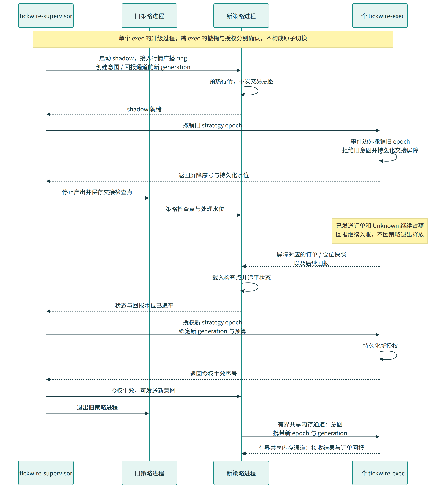

# 多策略进程、生产发布与生命周期

版本：v0.3 · 2026-10-20 · 状态：生产系统设计契约

策略可以独立新增、升级和退出，不替换行情或执行进程。`tickwire-md` 按产品提供行情，`tickwire-strategy` 每个实例独立运行，`tickwire-exec` 按账户风险域持有订单管理、逐单风控和交易网关。策略失联后，执行进程继续处理成交、维护预留并执行既定撤单和风险政策。

**所有交易授权的生效点都在 exec。** supervisor 发出命令、策略启动或共享内存创建成功，都不代表策略已经获准发单。授权必须由 exec 验证，在其单写事件循环中应用，并返回带执行代次和事件序号的确认。

发布支持两种完整契约：兼容状态的**原位移交**保留已有订单和持仓；不兼容状态的**受控撤单/退出**按批准的政策结束订单或处置持仓。发布不默认平仓，也不通过切换代次释放或重新分配同一笔资金。本文规定生产行为和验收条件，尚无对应 Rust 实现或 TLA+ 运行结果。

## 1. 进程边界与所有权

| 进程 | 所有权与职责 | 权限边界 |
|---|---|---|
| `tickwire-md-spot`、`tickwire-md-usdm` | 各自维护产品连接、协议解码、订单簿、流序号与订阅状态；向多个策略和 exec 分发 | 不持有交易凭证，不维护策略资金预留 |
| `tickwire-strategy` | 一个实例的信号、模型与决策状态；订阅一个或多个产品，提交订单意图 | 不持有执行凭证，不直接修改账户、订单和风控状态 |
| `tickwire-exec` | 一个账户风险域的连接、订单管理系统（Order Management System，OMS）、逐单风控、预留、成交去重、日志及对账；单写者更新 | 不加载策略代码，不等待策略进程完成风控 |
| `tickwire-supervisor` | 部署、控制授权、订阅与队列注册、发布协调、共享限流授权、进程监督 | 期望状态不能覆盖 exec 已应用事实，不直接创建交易所订单 |
| `tickwire-guardian` | exec 故障并完成实际隔离后，以独立认证连接查询和撤单，包括订单列表及算法订单关联子单 | 不持有正常策略增险授权；与 exec 的执行权按主设计协调，不能仅因失联就启动处置 |

共享全仓保证金、共享现货资产或共享逐仓资金来源的账户，仍归同一个 exec 风险所有者管理，或先由明确的预算协议分割。多个策略向同一 exec 提交意图，逐单检查和预留仍在 exec 串行完成；增加策略不会复制账户可用余额。

策略崩溃、卡死和内存错误被限制在策略进程内。exec 失效影响其整个风险域。策略故障由健康 exec 处理，不需要 guardian；exec 故障时由 supervisor 证明旧执行者已隔离，再授权 guardian 正式处置接管。隔离前的查询或预授权尽力取消不构成账户安全或新主授权的证明。策略代次、执行代次和真实发送者隔离是不同机制。

## 2. 多策略共享内存拓扑

### 2.1 固定通道与独立消费进度

热数据使用固定 Tickwire 布局的共享内存进程间通信（Inter-Process Communication，IPC）。Linux `memfd` 与文件描述符（File Descriptor，FD）能力控制负责建立映射和访问边界；生命周期必须遵循主设计的跨进程原子、版本和资源回收契约。

| 方向 | 拓扑 | 内容 |
|---|---|---|
| md → strategy | 按 topic/QoS 划分的 Disruptor 共享广播 ring，单份事件、每策略独立 cursor/gating | 行情事件、流/环代次、序号和订阅状态；同一组消费者读取同一份已发布事件 |
| md → exec | 同一广播机制，exec 独立订阅和独立消费进度 | 风控需要的行情、标记价格及有效性；不经策略转发 |
| strategy → exec | 每个 `(strategy instance, exec 风险域)` 独立固定记录 SPSC | 新单、撤单、改单意图；携带身份、授权代次及幂等键 |
| exec → strategy | 每个 `(exec 风险域, strategy instance)` 独立固定记录 SPSC | 接纳/拒绝、订单与成交变化、账户视图和恢复边界 |
| supervisor ↔ 各进程 | 版本化控制通道 | 映射、兼容性、订阅、授权、发布和恢复命令及实际确认 |

行情采用广播语义，每个订阅者都能读取同一事件；单生产者单消费者（Single Producer Single Consumer，SPSC）队列则用于策略与 exec 的独立命令/回报通道。广播读者推进读取位置不等于已经释放所有借用；gating 必须以不再访问旧槽位的释放进度为依据。进程内 Rust 队列类型不能未经跨进程布局和生命周期验证直接放进共享内存。

md 维护产品订单簿，策略按需要维护本地视图和特征，exec 订阅风控所需的最小可信状态。跨产品策略连接多个 md 与 exec，不假定它们存在统一交易所序号。

新增实例时，md 在自己的有序处理边界生成快照 S，并在发布后续 S+1 前登记该实例的订阅起点和保留约束。新实例先装载快照，再连续消费增量；快照构造、传送和追平所需的容量纳入准入检查。exec 也为该实例单独建立带序号的只读账户视图。注册不重启 md/exec，不授予交易权；同一逻辑策略的 Shadow 和 Active 实例拥有各自的订阅与回报进度。

### 2.2 慢策略隔离与 ring bank 切换

每个 topic/QoS 广播组预分配有限个 ring bank。md 根据各消费者释放进度计算可复用槽位，在高水位、慢策略或疑似故障读者出现时，提前将当前 ring 冻结在序号 S，并将后续事件写入新 bank 的 S+1。健康消费者连续读完旧 ring 至 S，确认旧槽位不再被使用后，按切换记录转入新 bank；不能跳过交接区间。

旧 ring 冻结后不再写入，未释放读者可以继续访问其已有槽位。只有收到该读者明确的 quiesce ACK，或通过 `pidfd` 等机制确认进程确已退出，才能从相应活跃 gating 集合摘除。心跳超时、读取 cursor 前进或策略授权撤销，都不能单独证明它已停止读共享内存。

新 bank 的订阅集合按明确的切换协议建立，旧读者并未因此从旧 ring 的回收约束中消失。旧 ring 只有在全部 holders 释放或确实退出后才能回收。落后者恢复读取旧 ring 后，若无法取得新 ring 的完整后续区间，则重新进行快照与增量衔接，不能把新 bank 的当前头部当作连续历史。

bank 数量有限。读者迟迟不释放而导致预留 bank 耗尽时，对应广播组进入不可发布/不可交易状态，依赖它的 exec 禁止新增风险；不能覆盖旧读者或无界扩容以维持表面吞吐。容量准入、切换高水位和强制终止故障实例的流程都要纳入生产压力验收。

`Lagged` 实例停止真实增险意图。exec 根据可信 md 的订阅状态、数据流代次及自身行情新鲜度拒绝失效输入。失效按 `instance_id` 和订阅代次匹配：Shadow 落后使它失去 Ready 条件，不能仅因逻辑策略 ID 相同就撤销旧 Active 实例的授权。记录 md 发现、exec 观察和门禁生效时刻；通知传播不是瞬时全局动作。只保留最新值的订阅必须在策略契约中明确，不能用于需要完整增量的订单簿、逐笔信号或私有成交事实。

### 2.3 注册、失效与重建

通道描述包含 `channel_id`、`channel_epoch`、`ring_epoch`、布局版本、容量、消息上限、生产者和消费者身份。共享内存不包含进程私有指针、Rust 堆对象或函数地址；行情槽位映射对策略只读，控制区域按各端所需能力授权。

exec 自行验证意图通道身份，策略持有某个 FD 不等于拥有交易授权。重建采用新对象、新代次；撤销旧授权后，确认借用和映射的退出条件，再回收旧资源。不能 truncate 仍可能被读取的对象，不能因 PID 被复用就把新进程视为旧实例。

## 3. 身份、意图与因果关系

### 3.1 稳定身份与运行身份分开

| 标识 | 含义 |
|---|---|
| `logical_strategy_id` | 稳定的逻辑策略身份；升级不改变，历史订单和虚拟持仓继续归属它 |
| `strategy_version` | 代码、模型、配置摘要；说明运行什么，不授予交易权 |
| `instance_id` | 每次启动生成的新身份，进程重启不能沿用 |
| `strategy_generation` | exec 对 `(logical_strategy_id, account_domain)` 接受的单调授权代次 |
| `exec_epoch` | exec 启动和恢复代次，绑定意图、授权与回报 |
| `feed_generation / channel_epoch / ring_epoch` | 行情有效历史、通道和物理环的代次，与策略授权分别管理 |
| `order_owner_revision` | 订单管理权和已接纳动作的版本，用于交接及撤改并发校验 |
| `operation_id / operation_revision` | 一次发布、回滚或退出操作及其持久状态版本 |
| `control_epoch / request_id` | 控制会话及幂等请求身份；同键不同内容拒绝 |

同一逻辑策略可以有多个 Shadow 实例，但在一个风险域内最多一个代次可提交新增风险。不同逻辑策略可以并行拥有独立授权，共同受到 exec 的账户检查。

连续的 ring bank 切换只改变 `ring_epoch`，不自动改变 `feed_generation` 或 `strategy_generation`。策略版本升级也不要求 md 更换 ring。因果记录保存环代次用于定位数据，行情是否有效仍由可信流代次、连续性和新鲜度决定，不能仅因物理环已切换就认定旧事件失效。

订单永久保留 `origin_strategy_id`、`origin_instance_id`、`origin_generation`；当前管理它的 `manager_generation` 另存。移交管理权不改历史归属、不改交易所订单身份，也不清零累计成交。

### 3.2 意图与回报的身份

意图包含策略与 exec 身份、`intent_seq`、`economic_intent_id`、有效期、目标风险域、配置版本，以及有界 `trigger_refs`。行情引用标明产品、md/流代次、序号、标的和观测时间。跨产品决策保存引用向量，不伪造全局序号。

`economic_intent_id` 标识持续中的业务动作，例如一组对冲任务。请求重试、回放和版本接管不能把尚未解决的同一动作换个 ID 重做。`intent_seq` 用于授权代次内去重；交易所 `clientOrderId` 由 exec 按持久化分配规则生成。

exec 的 `Accepted` 表示意图、预留和恢复记录已达到配置的生产提交水位，不表示交易所接受；此前的 `Received/Prepared` 只表达本地传输/准备状态。策略丢失确认后以原键查询或重试，exec 返回原订单身份和当前结果。Shadow 和历史回放输出使用隔离通道；生产意图入口还必须由 exec 检查授权，不能只依赖策略自律。

记录 md 接收/发布、策略取出/决策/提交、exec 取出/风控/提交传输层时间。排队计入行情到订单总延迟，时间戳带时钟域和必要的主机启动标识。exec 使用自身行情和账户事实检验策略引用，不信任“有效行情”或“只减仓”等调用者标签。

## 4. 接纳、公平调度与最终门禁

每策略独立设定队列容量、接纳速率、未决订单数和风险预算。exec 按权重轮转，每队列同时限制消息数和处理时间；不先排空一个策略再检查其他策略。非法或持续超限输入只隔离对应实例，解析工作也必须有界。

私有回报、授权撤销、故障处置和发送完成通知有独立处理预算。撤单有预留容量，但仍校验归属和速率，防止撤单洪峰阻塞其他策略。压力验收覆盖单策略满载、多策略满载、慢消费者和私有回报洪峰。

supervisor 为跨进程共享的 IP、UID 和接口限额预授不重叠的本地额度；逐笔发送不远程申请批准。请求限流与资金风险是两套账。exec 串行管理资金预留，策略预算不是另一份账户余额。

策略意图使用 `StrategyGrant`，exec 自主风险处置使用绑定政策/事件的 `ExecutorRiskAction`，guardian 使用 `GuardianEmergencyGrant`；三者不能互相替代。策略撤权后，exec 仍可按处置授权撤单，不要求旧策略重新获权。无新敞口的 CancelOnly/查询与新增订单使用不同前提，受控取消不因市场数据失效而被统一禁用。

意图接纳和首次进入任何可能输出的 TLS/socket 缓冲前，分别执行门禁。等待日志水位或 socket 可写后必须重查授权、发布操作状态、意图期限、配置、行情/账户有效性及预留。已经进入 `MayHaveSent` 的订单由 exec 继续处理，不能因策略撤权按本地失败释放。

同一订单的撤改带预期 `order_owner_revision`。exec 逐单串行接纳；先前已经接纳的撤改不会被发布切换抹掉，新管理者从快照与回报得知其在途状态后再作决策。迟到确认按原动作身份处理，不能覆盖较新的订单或管理权版本。

## 5. 可独立恢复的策略状态

### 5.1 发布工件与检查点

每个策略版本提供运行工件、配置/模型摘要、输入和输出 schema、支持的产品/仓位模式、存量订单能力、策略状态版本、迁移函数及回滚兼容性说明。迁移在策略进程或隔离工具中执行，不把策略代码加载进 exec。

版本化 `StrategyCheckpoint` 至少包含：逻辑身份和来源实例/代次、状态 schema、代码/模型/配置摘要、完整性校验、策略自有状态、随机数状态、定时器逻辑时间、实际消费输入日志位置、各行情流位置、各 exec 已应用位置、最后产生的意图序号及未解决经济动作。只保存一个模型参数文件不足以恢复有状态策略。

检查点必须对应明确的处理边界。持久化清单只引用已完整写入并验证的检查点和输入日志区间，不能把正在序列化的文件发布为可恢复版本。检查点不包含可直接复用的 FD、内存地址或旧实例交易授权。

### 5.2 输入日志与无副作用回放

确定性恢复需要保存策略实际应用输入的顺序，包括行情、exec 回报、计时事件、配置和外部模型输入。仅保留各来源自己的序号，不能还原多个来源在策略中的实际合并顺序。重放使用虚拟时间和记录的随机状态，真实下单输出始终关闭。

策略声明一种明确恢复契约：

| 契约 | 需要的恢复证据 | 无法满足时 |
|---|---|---|
| `deterministic_replay` | 版本化检查点及所需的完整、有序、可恢复输入区间；产生外部动作所依赖的状态能够重建 | 等待恢复证据或保持 Frozen，不以近似状态自动发单 |
| `declared_rebuild` | 策略明确定义可从 exec 当前订单/持仓和保留行情窗口重新构建的状态、预热要求及验证标准 | 重建/预热失败保持 Frozen，不临时切换恢复语义 |

精确恢复模式下，exec 放行真实增险动作前必须具备相应策略恢复证据的有效水位；如证据持久化落后，意图等待或被拒绝，等待计入延迟。采用异步留档不能同时承诺任意掉电后精确恢复未保存的策略状态。可重建策略按其经过批准的契约重新计算，不宣称与旧进程丢失的局部状态逐位一致。

恢复依赖集合绑定同一个生产故障模型：策略检查点、有序输入、代码/配置、exec 意图/授权与交接记录均进入主设计的 `RecoveryManifest`。默认LocalDurable+AsyncReplica要求源本地闭包完整，后台复制端ACK也覆盖其闭包；源盘丢失而副本缺尾部时不承诺接管。显式SyncReplica才在发送前要求依赖已在指定镜像持久化。不能只有订单WAL远端副本而缺检查点/输入；具体提交/提升规则见[复制契约](replication-and-failover.md)。可信持久化服务提供内容哈希和覆盖水位，策略自报水位或研究 recorder 的尽力留档不构成提交证明。

策略未转移本地内存就退出时，新实例仍能从检查点/日志或声明的重建输入恢复。exec 的接纳账本、真实订单和经济事实决定已经发生的外部动作；策略缓存的输出仅供核对，不能独立授权重发。

## 6. 两种生产发布方式

[图源](../assets/strategy-rollout.mmd) · [SVG](../assets/strategy-rollout.svg)。图展示单个 exec；跨 exec 的准备、管理权提交和增险放行按第 9 节分别确认。

### 6.1 原位移交：保留订单与持仓

原位移交要求新版本能解释已有策略状态、存量订单、仓位模式和经济动作。它改变策略管理权，OMS、交易连接、订单身份、持仓账本和资金预留一直留在原 exec。

| 阶段 | 实际动作与完成证据 |
|---|---|
| `Preflight` | supervisor 创建持久 operation，固定成员 exec、目标版本、迁移/回滚方案和风险政策；各 exec 验证能力和预期旧代次 |
| `ShadowReady` | 新实例以无交易权身份加载版本化检查点、订阅行情和 exec 回报；迁移与兼容性检查通过，模拟输出独立保存 |
| `QuiesceOld` | 各 exec 在本地事件序号 `s_revoke` 撤销旧代次新增动作权限；旧策略停止生产并生成最终检查点，或按恢复契约重建所需状态 |
| `SealOldInput` | exec 固定已接纳意图集合和每单在途动作；被撤销代次中未被接纳的意图永久拒绝。旧队列仍有字节不妨碍封口，不能事后重新接纳 |
| `CaptureState` | exec 发布带 `exec_epoch / exec_seq=S / handover_version` 的订单、预留、归属持仓和待决项快照；从 `S+1` 提供连续增量 |
| `CatchUp` | 新实例核对最终策略检查点、exec 接纳结果及快照，清理未接纳的旧输出，连续应用后续行情和回报；确认相关状态版本和在途动作 |
| `Prepared` | exec 持久化旧授权撤销、移交清单、目标代次与拟授权记录；新实例具备处理已有订单/持仓的能力，新增风险闸门仍关闭 |
| `CommitOwnership` | exec 在单写事件中复核清单，切换 `manager_generation` 与管理权版本；原订单和预留不变，返回实际 Applied 证明 |
| `ReleaseRisk` | 满足单域或第 9 节多域条件后，由 exec 应用明确的增险放行事件；新策略得到相应确认后才输出真实新意图 |
| `Finalize` | 确认旧授权已在全部成员域撤销后退出旧实例，按 IPC 生命周期回收；历史归属和迟到回报继续保留 |

旧策略的合作有助于生成最新检查点，但它的“我已停机”不能替代 exec 撤权。旧策略卡死时按恢复契约从持久状态重建；无法重建的状态进入受控退出或 Frozen，由 exec 继续管理已有订单。

exec 快照是其本地有序状态在 S 的切片，不冒充交易所原子快照。S 之后的成交、撤改、费用和账户变化继续发生。新实例必须连续追到 exec 指定的相关交接边界；涉及待决项、订单管理权或持仓解释的变化会更新 `handover_version`，过期确认不能提交。价格持续变化由 exec 的当前风控与最终门禁处理，不要求为了交接暂停整个市场。

### 6.2 受控撤单或退出

当状态不兼容、策略需要更换经济目标或操作者明确选择退出时，operation 指定逐类订单和持仓政策：撤销挂单后保留持仓、取消特定订单后移交其余订单、按限价/滑点/时间/最大敞口约束减仓，或完成全部退出后启动目标版本。

exec 先撤销旧授权，再执行批准的撤单和受约束处置，不依赖旧策略继续响应。撤单请求不等于撤单完成，部分成交和 Unknown 继续入账、占额和核查。只有政策要求平仓时才执行平仓；发布本身不隐含市价清仓权限。

完成条件由实际订单事实、持仓和待决项决定。超时进入 operation 的失败或受限处置状态，不能用一个“升级超时”事件直接释放资金、跳过未知订单或强行激活新版本。

## 7. 旧代次动作与管理权移交

| 切换时的事实 | 原位移交的处理 | 受控退出的处理 |
|---|---|---|
| 意图仍在策略→exec 队列，未接纳 | 旧代次拒绝；新实例不能把未确认输出直接重发 | 同样拒绝 |
| 已接纳且能证明没有交给任何可能输出的缓冲 | 移交清单逐项选择 `terminate_local` 或 `adopt_pending`；后者保留原身份和预留，切换管理代次后重新检查期限、行情及风控才允许首次发送 | 本地终止，记入恢复结果后释放对应预留 |
| 已经 `MayHaveSent`，确认未到 | 原身份保留，传输推进/查询由 exec 处理；新实例接管观察与后续管理，不重发原请求 | 查询并按事实撤单；继续占额 |
| 已确认活动订单 | 原订单继续存在；原子更新管理权版本，保留全部在途撤改记录 | 请求撤单并等待实际结果 |
| 撤单或改单已被 exec 接纳，但结果未知 | 已接纳动作继续处理；新管理者须确认其状态，后续动作按订单版本串行检查 | 继续处理并核查，不再叠加无边界撤改 |
| `Unknown` | 完整列入清单，按第 8 节限制新风险；转移的是核查责任，不是“重新发送许可” | 保持占额并核查 |
| 已终态但迟到成交、费用或更正到达 | 按原订单/逻辑策略归属入账，向当前管理实例发布新事件 | 同样入账，不因策略已退出丢弃 |

`adopt_pending` 是显式 exec 事件，不是修改旧消息的 generation 后重新入队。最终门禁检查当前管理代次、移交记录和原意图身份；原始来源字段不变。已过有效期的旧报价不能通过移交恢复有效。

例如，旧代次 17 的订单在 exec 快照时还剩 6 手，快照后又成交 1 手；新代次必须在确认交接前消费这笔回报，或接受更新后的交接版本。切换后再到的旧订单成交仍归同一逻辑策略，由新实例观察；资金不会因 17 变成 18 被释放再扣一次。

## 8. 持仓、未知状态与额度

### 8.1 逻辑归属稳定，管理者可以切换

原位升级保持 `logical_strategy_id`，策略虚拟持仓、实际订单和资金预留不搬离 exec。非零持仓不要求平仓，但新版本必须支持当前产品/仓位模式，接受有版本的存量持仓基线和风险政策。

跨逻辑策略移交使用独立的 `TransferAttribution` 事件。同一 exec 内同时扣减来源账本、增加目标账本并更新风险归属，总账户资产和数量不变；双方政策与目标容量通过检查。它不是交易所成交，也不是资产划转。跨 exec 的移交按第 9 节的多域操作处理，不能用两个独立写入冒充原子转移。

严格账户预留要求所有主动写入经同一 exec 或交易所真实隔离的预算域。仅观察其他机器人/手工交易的后到回报不能提供并发预留保证；发现绕过入口的活动时停止新增风险并核对，外部活动不能通过随意归属转移“变成已经风控”。

共享净仓账户可能存在策略虚拟持仓互相抵消。exec 检查实际账户和所有可能成交订单，不能让策略凭“关闭自己的虚拟仓位”跳过账户风险检查。无法归属的费用、资金费率、强平或外部调整进入明确的待分配账项；不通过任意调整策略持仓掩盖账户差额。

### 8.2 何时阻止自动接管

| 情况 | 管理权与交易权限 |
|---|---|
| 订单、持仓和回报完整，新版本兼容 | 可原位移交，保持订单与预留；按 operation 条件开放新风险 |
| 已知、可枚举的 Unknown，订单身份和保守风险上界完整 | 可以移交观察/核查责任；相关经济动作、标的或风险范围保持禁增险。只有独立可证明安全的其他范围才可授权交易 |
| 恢复介质/副本缺少已提交证据而无法枚举未知意图，或余额/持仓差额无法解释 | 整个风险域冻结新增风险，不能只冻结一个策略后把余额给其他策略 |
| 新版本不支持已有持仓/订单类型，状态迁移或输入覆盖失败 | 不自动提交管理权；选择受控退出、兼容版本回滚或保持 Frozen，由 exec/guardian 按职责处理 |
| 新实例未追平回报，或确认了过期交接版本 | 不开放新风险；刷新快照/增量或交接版本 |

允许 Unknown 的受限移交必须明确其可影响的风险集合和保守占用，不能以“有预留”笼统推定任意其他交易安全。未解决的同一经济动作不得由新实例新建订单 ID 重试。

### 8.3 授权撤销不等于预算释放

策略撤权、进程死亡、回报确认和共享内存回收均不释放订单资金。exec 只在本地未发送得到证明、权威订单事实到达、成交转成实际现金流，或明确的账本移交成立时调整风险占用。

新实例使用同一逻辑策略在现有持仓和全部活动/未决预留之后的剩余额度，不重新领取整份预算。限流授权也只有在旧消费方已停止使用且余量可核对后才回收；已发送或结果未知请求按限流契约保守记账。

## 9. 多账户与跨 Spot/Futures 发布

### 9.1 持久 operation 状态

supervisor 的发布协调器持久保存 `operation_id`、成员域清单及摘要、源/目标制品、每域预期代次、状态版本、检查点和交接版本、exec Applied 证明、补偿与回滚政策。状态更新使用比较版本的提交协议；重试同一控制键返回原结果，不重复分配资金或再做一次移交。

操作状态为 `Preflight → ShadowReady → Quiescing → StateReady → PreparedAll → Committing → ActiveAll → Finalized`。成员失败进入 `PartialCommitted / Compensating / Frozen`；回滚进入 `RollbackPreparing → RollingBack → RolledBack`。每次状态变化都基于成员 exec 的实际确认，supervisor 自身发送成功不推进成员状态。

每个域拥有自己的撤销点、快照序号和授权代次，不存在跨 Spot/Futures 的全局原子切换。

### 9.2 部分提交时先关闭新增风险

各 exec 提交管理权时，新的增险闸门仍关闭。协调器收齐成员的持久 Prepared 与实际管理权提交证明后，才能生成绑定 `operation_id/operation_revision`、成员清单、各 exec 代次、策略代次、交接版本、每域 `risk_gate_revision` 和有效期的组就绪凭据。exec 验证凭据并应用自己的 `ReleaseRisk`；新策略也必须收到所需域的确认才能发跨域意图。

每次 Halt、Compensate、撤权或其他关闭动作先在 exec 单写状态机关闭闸门并推进单调 `risk_gate_revision`，随后持久化；正常 applied 确认绑定该版本。`ReleaseRisk` 只能对预期版本做比较后应用，同时验证 operation 尚允许放行。关闭后晚到的旧凭据即使尚未过期也不能重新开闸；再次开放需要新 operation revision/新凭据。exec 重启总从 Frozen 和新 exec 代次开始，不从旧 Active 检查点直接恢复发单。

若只完成部分管理权提交，尚无有效组凭据，任何成员都不能因“本域升级成功”自行开放该组新增风险。协调器进入 `PartialCommitted`，对已提交域保持或重新应用禁增险，并按政策继续完成、回滚或受控退出。已有订单的回报和 exec 处置继续运行。

组凭据证明各域曾达到规定状态，不能证明它们未来同时可用。放行传播期间或之后任一域仍可能故障、拒单或超时；检测后协调器和 exec 关闭相关风险闸门，使用已批准的补偿政策。不同域停止存在传播窗口，这部分风险纳入最大未对冲量、持续时间、最坏成交和限流预算，不能用“多域提交”掩盖。

跨域订单带 `hedge_group_id / leg_id`。另一腿计划成交不能提前增加可用资金或抵扣未知敞口。补偿可能是撤单、受限对冲或保持风险等待查询，不能无限循环生成新对冲单。跨账户资金划转有独立的来源扣账、目标确认与待决状态，发布切换不隐含划转。

## 10. 失败回滚与重启恢复

### 10.1 回滚恢复代码管理权，不回滚已经发生的成交

准备发布时验证回滚制品、可读取的检查点/日志区间及当前订单类型兼容性。回滚创建新的 operation 和更高 `strategy_generation`，启动新 `instance_id`；已撤销的旧代次永不恢复授权。

若新版本尚未开放风险，按最新 exec 订单/持仓快照把管理权交给回滚实例。若新版本已经交易，回滚必须包含新增订单、成交、费用和当前持仓，不能恢复旧账户快照抹去这些事实。旧代码无法解释新订单类型或策略状态时，先按受控退出政策处理不兼容部分，再激活兼容管理者；不能宣称任意状态迁移都有自动逆操作。

新版本的 Shadow 检查失败且旧代次尚未撤销时，可终止本次操作并保持旧实例运行。旧代次一旦撤销，即使没有发生新交易，也必须通过新代次流程重新授权。

### 10.2 不同进程故障

| 故障 | 立即处理 | 恢复依据 |
|---|---|---|
| strategy 卡死/退出 | 健康 exec 撤销该实例权限并执行登记的 `on_strategy_loss` 政策；不等待策略撤单 | 新实例从检查点/日志或声明的重建契约恢复，再核对 exec 事实 |
| md 重启/连续性丢失 | 失效相关 feed/channel 代次，策略和 exec 各自恢复视图 | 新订阅绑定和行情有效性由 exec 应用后才允许相关增险 |
| exec 崩溃 | 旧 `exec_epoch` 意图不可进入新实例；策略停止相关域交易 | 实际隔离旧 exec；guardian 可查询/撤单；新 exec 对账并建立新基线，重新逐策略授权 |
| supervisor/协调器重启 | 不从缓存的期望状态批量 Resume，不重发满额授权 | 恢复持久 operation，查询每域 Applied 状态和余量，以新控制会话继续或补偿 |
| 通道或策略回报缺口 | 相关策略停止增险，exec 继续入账和风险处置 | 按序重放或快照加增量恢复；身份与代次重新绑定 |

策略没有执行凭证，所以 exec 授权代次可以拒绝旧策略迟到写入；旧策略是否已退出不是撤销其交易权的唯一依据。旧 exec 则必须被真正阻止访问交易端点，心跳、租约和共享内存 epoch 都不能代替隔离。

### 10.3 回报队列满与追平屏障

exec→strategy 队列满时，exec 继续处理交易所事实，将该实例通道标为 `ResyncRequired`。若实例正持有活动授权，则关闭它的增险权；若它只是 Shadow，则清除它的 Ready 条件，不影响同一逻辑策略的旧 Active 实例。策略以 `(exec_epoch, last_applied_exec_seq)` 请求续传；区间完整则重放，否则由 exec 在同一有序状态机中产生快照边界 S 并接续 S+1。再次溢出就重新同步，不能跳过缺口宣称 Ready。

消费确认只证明策略视图进度，不代表订单终态或资金可释放。exec 应用恢复确认并重新检查 operation/授权状态后才恢复交易权，策略本地“已追上”标志没有放行效力。

### 10.4 提交水位与证据不完整

生产的 `Accepted` 和任何可能发送的意图都依赖约定提交水位。崩溃可以丢失未提交的 Prepared 尾部，但该尾部不能已经进入传输层。策略缓存的 Received/Prepared 不是交易所结果，也不授权换 ID 发送；重启后向 exec 按原键查询接纳账本。

若恢复介质损坏、读取了未达到提交水位的副本，或发现可能发送的意图没有恢复记录，属于恢复证据失效。整个风险域冻结，使用检查点、订单 ID 范围与交易所事实核对，不把这种情形当作合法的快速发送模式。所有策略受共同账户不确定性约束，只有重新闭合对账与授权后才可增险。

恢复后重建发布 operation 的实际状态和管理权，拟授权记录不会自动变成 Active。明确的未知经济动作必须解决，或进入第 8 节经过验证的受限风险契约。

## 11. 候选 TLA+ 动作与不变量

TLA+ 描述状态转换，TLC 执行有限状态检查。正式模型应对应实际 Rust 转换、持久化点和跨进程并发点；本文件只是建模契约，不代表已有模型检查结果。

候选变量包括：exec/control 代次、每策略活动授权、管理权版本、operation 阶段、策略检查点与输入覆盖、通道与借用引用、已接纳意图、订单发送阶段、预留和持仓归属、日志水位、回报位置及多域就绪凭据。

| 候选动作 | 必须覆盖的交错 |
|---|---|
| `PublishIntent / AcceptIntent / RetryIntent` | 接纳后确认丢失、旧队列迟到输入、重复键不同内容 |
| `Revoke / SealOldInput / FirstTransportAccept` | 撤销与首次可能发送交错；未接纳旧输出与新实例重放 |
| `CaptureCheckpoint / ValidateInputCoverage / ReplaySuppressed` | 策略崩溃、输入日志缺口、不同来源合并顺序、历史输出重复 |
| `SnapshotExec / CatchUp / RefreshHandover` | 快照后成交、费用和订单修订变化，新实例确认过期基线 |
| `PrepareGrant / CommitOwnership / AdoptPending / ReleaseRisk` | 日志水位、部分写、配置变化与管理代次切换 |
| `Fill / CancelAck / ResolveUnknown / TransferAttribution` | 迟到成交、在途撤改、虚拟仓位转移与预留变化 |
| `LagSubscriber / FreezeRing / SwitchBank / QuiesceReader / Reclaim` | 读取位置已前进但借用未结束、旧环冻结 S 与新环 S+1 衔接、读者卡死、banks 耗尽 |
| `CrashStrategy / CrashExecDropTail / FenceExec / GuardianCancel` | 策略卡死但 exec 健康；旧 exec 恢复；guardian 权限交接 |
| `CommitOneDomain / IssueGroupCertificate / MemberFailure / Compensate` | 部分提交、放行传播、单腿成交和补偿失败 |
| `Rollback / RestartCoordinator / RetryControl` | Applied 丢失、旧控制会话迟到、回滚期间新增成交 |

必须保持的安全性质：

1. 同一 `(logical_strategy_id, account_domain)` 最多一个代次可新增风险；多个不同逻辑策略可以并行获权。
2. Shadow、历史重放及仅持有共享内存 FD 的进程无法通过 exec 生产入口发送订单。
3. 新发送只能由具有实际执行权的 exec 完成，且最终门禁验证当前管理授权、operation 状态和必要恢复证据。
4. 被撤销代次未接纳意图永不恢复接纳；已接纳未发送意图只有经显式 AdoptPending 才能由新代次继续，身份和预留保持唯一。
5. 同一意图键最多建立一个逻辑订单，未知经济动作不能通过新实例、新请求 ID 或回滚无限重复执行。
6. 策略撤权、进程退出、队列回收和超时本身不释放可能已发送订单的资金或保证金。
7. 原位管理权移交不创建、删除或复制经济事实；累计成交和历史归属不因 generation 变化回退。
8. 策略检查点、exec 快照和后续事件具有可验证的覆盖关系；恢复和回滚不会产生未授权的历史发送副作用。
9. 旧 ring 仍有合法未释放借用时不能复用；读取 cursor、策略撤权和实例心跳超时都不能冒充 quiesce ACK 或进程死亡证明。
10. 缺少必要成员证明的部分提交不能开启跨域新增风险；Halt/补偿推进 risk_gate_revision 后旧 ReleaseRisk 凭据不可重开闸；成员放行后的故障仍受独立风险与有界补偿约束。
11. guardian 的正式处置接管、风险释放和新主授权要求旧 exec 已实际隔离；隔离前允许明确授权的查询/尽力取消，但不宣告 Safe。策略故障不会误触发执行者接管。
12. 额度回收需要相应停止使用和核对证据，策略、exec 或 supervisor 重启不能复制未结额度。

活性性质单独声明条件：调度公平、存储与输入覆盖可用、消费者可恢复、交易所提供足够历史和最终结果、旧执行者可隔离。条件不成立时保持受限或 Frozen，不能为了让模型最终到达 Active 而加入无依据的超时释放。

## 12. 生产验收场景

| 场景 | 应验证的结果 |
|---|---|
| 多策略共享广播 ring，其中一个借用槽位后卡死 | 旧 ring 冻结至 S，健康者连续转入新 bank S+1；旧槽位不复用，读者摘除与回收具备证明 |
| 多个故障读者占满全部预留 banks | 对应行情组停止并触发 exec 禁增险，不覆盖旧读者或无界扩容 |
| 一个策略持续满队列或发撤单洪峰 | 其他策略、私有回报、授权撤销和风险处置仍满足声明的调度预算 |
| Shadow 进程伪造真实意图或复用 Active 通道描述 | exec 从身份/通道/授权绑定拒绝，不能依赖 Shadow 配置开关 |
| 同一逻辑策略的新 Shadow 行情或回报队列满 | 只清除 Shadow 的就绪状态；旧 Active 不因逻辑 ID 相同被错误撤权 |
| 有活动订单和非零持仓时原位升级 | 订单 ID、累计成交、预留和逻辑归属保持；管理代次原子切换，没有强制撤单/平仓 |
| 旧意图等待日志或 socket 时撤权 | 按显式 terminate/adopt 政策处理，首次发送门禁有效；已可能发送仍继续核查 |
| exec 快照后成交，切换后再收到旧订单费用 | 新实例通过增量和交接版本取得正确状态；迟到事实仍入账且无重复 |
| 策略未传递内存就退出 | 按声明契约恢复状态并核对 exec 接纳账本；缺失恢复证据时不自动输出历史意图 |
| 不兼容状态或订单类型 | 原位提交被拒绝；执行已批准的受控退出或兼容回滚，不静默降级 schema |
| Unknown、无法解释账户差额或已提交恢复证据缺失 | 相关范围或整域按契约冻结，资金不重用，原经济意图不重发 |
| Applied 确认丢失后控制请求重试 | 返回同一实际结果，不再切一次管理权、分配资金或执行仓位转移 |
| 仅 Spot 提交成功，Futures 提交失败 | 组增险闸门保持关闭，operation 进入部分提交和补偿；不声称全局原子成功 |
| 组放行后单腿成交、另一域失联 | 最大未对冲风险和有界补偿生效，不无限发新对冲意图 |
| 新版本已经成交后回滚 | 使用新 instance/generation 读取当前经济事实，不恢复旧余额或删除新成交 |
| 策略故障与 exec 故障分别注入 | 前者由健康 exec 继续入账撤单；后者完成实际隔离后 guardian 才查询/撤单 |
| 旧进程恢复、旧控制命令迟到或 PID 复用 | 旧身份/代次无权新增动作，未释放映射和引用不被误回收 |

性能验收记录订阅者数量、各策略负载、事件大小、读取与释放滞后、ring bank 切换和回收时间、CPU/NUMA 布局及逐段排队分布。升级、回报追平、持久化等待、慢消费者与故障处置都进入同一测量链；正常态一次入队耗时不能代替生产行情到发单的分布。
