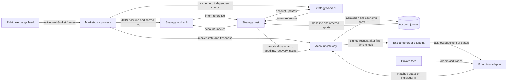

# Single-Host Trading Architecture

A single-host Tickwire deployment runs the public market-data publisher, hosted strategy workers, and the account execution runtime on one Linux machine. Each public market source binds at startup to a specific venue, native instrument symbol, and immutable catalog version, while each strategy worker subscribes to normalized shared-memory market streams and submits canonical trading commands into a single account risk domain. Within that risk domain, one account process acts as the sole state writer: it serializes competing claims on cash and margin, persists recovery dependencies and economic facts to a local write-ahead journal, and gates every outbound wire transmission right before the first plaintext byte enters TLS. Exchange and product coverage across deployments is summarized in the [exchange support matrix](../../README.md#exchange-support).

Separating market decoding, strategy execution, and account ownership into distinct OS processes isolates tail-latency interference and process faults without introducing cross-host consensus on the order path. The market-data publisher decodes native WebSocket frames once for any number of local readers; the strategy host supervises child worker processes and routes execution reports back to the originating strategy; and the account gateway enforces financial and authorization invariants even if a worker stalls, crashes, or submits stale intents.

## Components and Data Flow



The public market-data feed and each hosted strategy execute in separate processes, whereas the strategy host and `AccountGateway` share the single-threaded account process. When configured with market sources, the account process also attaches directly to the shared-memory publisher so `ControlPlane` can verify feed liveness, sequence lag, and quote age independently of strategy claims before admitting risk-increasing orders.

| Component | Owner / Caller | Contract and Data Boundary |
| --- | --- | --- |
| Venue decoder | Market-data input thread | `Session::on_text` consumes venue subscription acknowledgements and quotes carrying source epoch, venue sequence, exchange and local receive timestamps, instrument identity, and integer bid/ask ticks and lots. |
| Shared publisher & JOIN | Market-data owner | `TopicPublisher::on_spot_quote` writes normalized quote and feed-health records into a shared-memory ring; JOIN supplies a consistent snapshot baseline and starting ring cursor to workers that attach after startup. |
| Strategy implementation | SDK worker process | `Strategy::on_market` receives a borrowed `MarketView`, reads normalized top-of-book state via `best_quote()`, updates worker-private algorithm state, and optionally emits a `CanonicalCommand`. |
| Intent writer & strategy host | SDK worker and account runtime | `IntentWriter::publish` persists canonical command bytes and transmits an intent reference over IPC; the receiving host resolves the payload, checks worker instance and intent sequence, and constructs a `Submission` carrying local order IDs, send deadline, and recovery dependencies. |
| Account gateway | Account runtime | `AccountGateway::submit` evaluates risk on a candidate `Account` and synchronizes recovery dependencies plus `Admit` to the WAL; `poll` rechecks the live `Gate` immediately before the first TLS write, while byte-identical retries return the stored status. |
| Execution adapter | Gateway and private-input owner | Signs outbound native requests and correlates inbound acknowledgements, order-status snapshots, and individual trade fills back to the admitted order before journaling each economic transition. |

## Core Invariants

* **Startup binding and epoch isolation**: Venue symbol formatting, decimal price/quantity scales, TLS session configuration, and ring capacity are bound during startup or reconnect rather than on the per-quote path. Every reconnect advances the source epoch and withholds trading eligibility until a fresh quote arrives on the new epoch.
* **Independent reader cursors over shared market memory**: Multiple strategy workers read the same memory-mapped publication ring through independent cursors. A slow worker never blocks publication or peers; if its cursor falls behind the retained ring window, it must re-synchronize through a fresh JOIN baseline before emitting new triggers.
* **Single-writer serialization per risk domain**: Strategies maintain independent logical IDs, instance UUIDs, and monotonic intent sequences, while one `AccountGateway` serializes every reservation against shared balances. All processes attached to an account point to the same journal directory and contend on one exclusive writer lock held for the writer's lifetime.
* **Configurable commit persistence (`InMemory`, `MmapAsync`, `LocalDurable`) and first-byte re-verification**: No request enters the outbound socket queue until its recovery closure and `Admit` record commit to the configured `StorageMode`: `InMemory` (default stateless RAM store for ephemeral public-cloud Pods using `SelfDescribingClientId` + cold exchange REST bootstrap), `MmapAsync` (preallocated `MAP_SHARED` segments + `MMAP-CURSOR.bin` + background `fdatasync` thread delivering ~100 ns hot-path commits with 100% deterministic `SIGKILL` recovery), or `LocalDurable` (synchronous `fsync` before queueing). If transport fails after partial acceptance, the reservation remains locked until venue reconciliation proves the terminal outcome.
* **Cluster-restore rejection on single-host state**: Moving an existing deployment requires copying the matching account journal, recovery object store, and input journal from the same history. Startup rejects directories carrying legacy cluster markers (`FAILOVER-IN-PROGRESS` or `FAILOVER-COMPLETE.json`) and rejects scalar business journals configured with `LegacySyncReplica` (`Error::UnsupportedProfile`), while still verifying historical strategy-handover evidence during replay.

## State Transitions and Failure Semantics

### Event-Loop Turn Ordering

In the Binance `CoreNode` runtime, a single event-loop turn polls the calibrated clock, public market stream, authenticated private stream, and up to `16` completed execution outcomes (`RestOwner::has_queued_outcomes`, keeping `Report::runnable = true` if additional completions remain queued) *before* polling strategies for outbound commands. `CoreNode` exposes `set_projected_fill`, `drain_projected_fills`, and `set_stp_enforcement` over `RestOwner`, allowing strategies and hosts to consume volatile `ProjectedFill` estimates ahead of `TRADE` frames and enforce local `StpBook` self-trade prevention (`Error::CrossesBook`) prior to wire transmission. When `RestOwner` runs in pooled HTTP/1.1 mode (`has_connection_pool()`), `CoreNode::registrations` registers active pool slots under `mio::Token(100 + conn_id)` via `RestOwner::reregister_all` while preserving `mio::Token(6)` in single-connection mode. Because inbound fills, modifications (`VenueEventBody::Modified` / `ModifyRejected`), and cancellations across all pooled links or multiplexed WebSocket requests are journaled and applied to `Account` earlier in the turn, subsequent strategy submissions in the same turn are evaluated against up-to-date balances, positions, and `StpBook` price levels. Local admission refusals (`CrossesBook`, `OrderNotOpen`, `TooManyPendingActions`, `InvalidPrice`, `InvalidQuantity`, `NoChange`, `InsufficientAsset`, `InsufficientCapital`, `Limit`, `ManagementDenied`) classify into `TerminalReason` via `tickwire_binance_account::Error::classify_refusal_reason`, remove the staged `RecoveryBundle`, and report a per-intent refusal to `Strategy::on_submission` without freezing `Account`, halting `CoreNode`, or deducting venue rate-limit quota. The runtime refreshes monotonic time after account polling and again prior to each submission, and enforces explicit `IoBudget` slices and `maximum_commands_per_turn` limits so a chatty feed or strategy cannot starve private-stream processing.

### Command Intake Gate

Both file-backed strategy queues and the hosted strategy IPC receiver pre-screen incoming commands through `Health::intake` before invoking candidate risk evaluation:

* **Wait before readiness**: If the clock is not yet calibrated (`!calibrated`) or the outbound gateway is halted (`sender_halted`), `Health::intake` returns `Intake::Wait` so queued requests stay buffered rather than failing spuriously during startup or transient transport halts.
* **Strict monotonic deadline expiration**: Once clock and sender state permit evaluation, `Health::intake` compares `command.context.request.deadline` against `now.monotonic.nanos()`. A deadline equal to or earlier than sampled monotonic time returns `Intake::Expired` (`Intake::DeadlineOverflow` if `Instant` conversion overflows).
* **Administrative priority under degraded health**: Fresh `Cancel`, `CancelList`, `CancelAlgo`, and `Query` commands return `Intake::Ready(deadline)` even when market data is stale, the private stream is disconnected, or `Account` is frozen, allowing risk reduction and state inspection during incidents. All other commands wait until `Health::ready()` confirms `calibrated`, `market_live`, `private_receiving`, `!account_frozen`, and `!sender_halted`.

`Health::intake` performs only enum pattern matches and checked integer subtractions with zero heap allocations. Passing intake schedules the command for gateway review; final permission to transmit still depends on durable admission and the synchronous first-byte `Gate` check inside `AccountGateway::poll`.

## Performance and Cost

| Architectural Decision | Saturation and Failure Behavior | Hot-Path Cost Profile |
| --- | --- | --- |
| Bind adapter and catalog at startup | Configuration or ownership changes pause new risk; restart replays unresolved exposure before reactivation. | Per-quote processing pays only fixed-point tick/lot conversion and integer comparisons; TLS handshakes, schema validation, and buffer allocation stay off the trading path. |
| Fan out market data via shared ring | A lagging worker loses its ring window and re-enters JOIN without delaying the publisher or healthy strategies. | One JSON parse and shared-memory write serve all local readers; each worker pays only its own cache-line reads and local replica update. |
| Single-writer account gateway | Competing workers queue behind one writer; bounded per-turn command budgets cap cross-worker head-of-line delay. | Eliminates cross-process locking on balances; end-to-end order tail latency includes local WAL `fsync` and TLS first-write readiness. |

On the Bybit and OKX public spot feed path, a single-slot bounded channel connects the WebSocket reader thread to the shared-memory publisher thread; if the slot is full, backpressure blocks the reader directly rather than growing an unbounded heap queue. Each complete two-sided BBO update writes two 512-byte ring records—one carrying exact integer quote ticks and lots alongside the receive timestamp, and one carrying feed health. Allocation-counting integration tests confirm zero heap allocations from the first acknowledged BBO text frame through shared-memory publication after startup (excluding kernel socket reads, TLS decryption, worker scheduling, checkpoints, and strategy callbacks).

### Reproduce native quote decoding

```sh
taskset -c 2 cargo bench --locked -p tickwire-md --bench spot_bbo_decode
```

The benchmark starts a timer on a complete native JSON text frame in memory and stops after constructing the integer quote input passed to the publisher, including the timer's own clock-read overhead while excluding TLS, cross-thread handoff, ring publication, worker wakeups, and disk I/O. Each release-build round measures 100,000 two-sided frames per venue following 4,096 warm-up frames. Across five rounds pinned to CPU 2 on a shared Ryzen 7 8845H host under WSL2, the median of the five reported percentiles was:

| Venue | p50 | p99 | p99.9 | Per-round p99.9 range |
| --- | ---: | ---: | ---: | ---: |
| Bybit | 601 ns | 1,393 ns | 10,811 ns | 3.1 – 27.1 µs |
| OKX | 872 ns | 1,483 ns | 13,085 ns | 3.8 – 24.8 µs |

### Cold First-Order Baseline (Binance `spot-fill` Fixture)

The Linux `spot-fill` lab fixture measures `eligible_quote_to_order_ns` across a complete local loop. After waiting for account reconciliation and a worker receipt confirming positive account position, the exchange fixture starts a monotonic timer when it first prepares a 60,000 USDT BTC bid in a depth snapshot or WebSocket frame, and stops the timer in the same exchange process immediately after reading the complete signed order HTTP request (prior to signature verification). The sample is emitted only after that order passes validation, the private fill is delivered, and the worker consumes all 11 durable account records. Unlike the [deployment latency budget](../contracts/deployment-reference-v1.json), which ends at the account process's first application write on a separate endpoint, `eligible_quote_to_order_ns` spans local TLS transport, ring publication, OS worker scheduling, strategy callback, recovery-closure persistence, WAL admission, and loopback return transport.

On a shared Ryzen 7 8845H host under WSL2 (release build, fresh account store per run, fixture/publisher/worker/account pinned across CPUs 0–3, where the cold first order also persists the worker executable into the recovery store), five consecutive cold runs recorded:

| Recovery Dependency Persistence Strategy | Five Cold First Orders, in Run Order (ms) | Median |
| --- | --- | ---: |
| Store dependencies, then reopen and `fsync` before binding | 207.7, 172.0, 1150.2, 242.4, 236.3 | 236.3 ms |
| Verify and `fsync` supplied bytes once, then bind | 1459.6, 143.0, 101.7, 94.1, 119.0 | 119.0 ms |

Syscall tracing of one cold order per implementation recorded 66 versus 36 account-process `fsync` calls (plus 2 `fdatasync` calls in each), with 64 and 34 of those `fsync` calls attributable to synchronizing recovery objects and their directory entries; concurrently, the worker process issued up to 305 sync calls on its own live input log while quotes arrived. Steady-state warm-order percentiles (p50/p99/p99.9) after initial dependency caching remain to be measured on dedicated bare-metal hardware.

## Acceptance

1. Feed identical fresh and expired new orders, cancellations, and queries through both the file-backed queue and the strategy IPC receiver, verifying `Health::intake` behavior exactly at `deadline` (`Intake::Expired`) and one nanosecond before `deadline` (`Intake::Ready`).
2. Run two strategy workers sharing a single risk domain and submit competing orders against the same cash balance; verify that both workers preserve distinct logical and instance identities, the admitted order reserves funds once, and crashing or halting one worker leaves its peer operational.
3. Across each supported venue, match outbound native symbol, client order ID, price, and quantity against the originating `CanonicalCommand`, then replay an acknowledgement, a terminal order-status report, and a duplicate trade fill—verifying that only the trade event books exact execution price and fee once.
4. Instrument and report input-to-publication, publication-to-callback, intent-to-admission, and admission-to-first-byte intervals separately across p50, p99, and p99.9 under both steady load and bursts on the target host, keeping loopback fixture timings distinct from production capacity claims.

## Verification and References

```sh
cargo test --locked -p tickwire-md --test spot_quotes
cargo test --locked -p tickwire-runtime -p tickwire-app
```

* Application entrypoint and runtime loop: [tickwire-app](../../crates/tickwire-app/src/main.rs), [CoreNode runtime](../../crates/tickwire-runtime/src/node.rs), [single-host reference config](../../config/reference.toml), [two-strategy deployment guide](../../README.md#deploy-two-strategies)
* Public market decoding and shared-memory fanout: [spot quote decoder](../../crates/tickwire-md/src/spot_quotes.rs), [quote allocation tests](../../crates/tickwire-md/tests/spot_quotes.rs), [BBO decode benchmark](../../crates/tickwire-md/benches/spot_bbo_decode.rs), [market publisher](../../crates/tickwire-market-publisher/src/spot.rs), [JOIN protocol](../../crates/tickwire-join/src/lib.rs), [public spot input spec](spot-quote-input.md)
* Strategy SDK and worker replay log: [strategy SDK](../../crates/tickwire-strategy-sdk/src/lib.rs), [market view](../../crates/tickwire-strategy-sdk/src/market.rs), [outbound intent writer](../../crates/tickwire-strategy-sdk/src/outbound.rs), [IPC runtime](../../crates/tickwire-strategy-sdk/src/runtime.rs), [live worker input log](../../crates/tickwire-strategy-sdk/src/replay/live.rs), [worker input spec](strategy-input-consumption.md)
* Account admission, recovery, and venue execution: [account gateway](../../crates/tickwire-account-gateway/src/lib.rs), [account gateway spec](account-gateway.md), [recovery dependency closure](recovery-closure.md), [Bybit and OKX spot execution](spot-execution.md), [spot-fill lab fixture](../../crates/tickwire-lab/README.md), [deployment latency contract](../contracts/deployment-reference-v1.json), [last cluster-capable revision](https://github.com/Obscurepawn/Tickwire/tree/dc50649ebdcada26f7740181c16139cd3b32064a)
