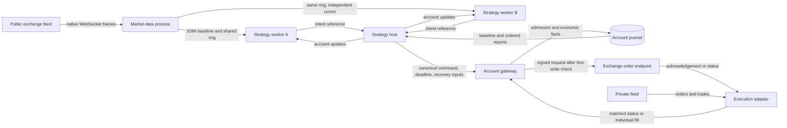

# Single-host trading

A deployment binds a public market source to a venue, a native instrument and a catalog version. A strategy instance subscribes to one or more normalized inputs and issues commands to its account risk domain. Each account serializes admission and writes economic facts to its journal. The deployment and exchange coverage appear in the [support matrix](../../README.md#exchange-support). The primary deployment target is one Linux host. Cross-host high availability is a separate deployment project.

## Components and data flow



The strategy host and gateway run in the account process. The public feed and each hosted strategy run in separate processes. The host owns the child processes and routes results back to the submitting member. The gateway owns the account state that all members draw on. The table follows a hosted strategy using the independent market publisher.

| Provider | Caller | API and data |
| --- | --- | --- |
| Venue decoder | Market-data input thread | `Session::on_text` consumes the venue's acknowledgement or quote. A quote carries source epoch, venue sequence, exchange and receive times, instrument, and bid/ask ticks and lots. [Spot decoder](../../crates/tickwire-md/src/spot_quotes.rs) |
| Shared publisher | Market-data owner | `TopicPublisher::on_spot_quote` publishes the quote and feed state. JOIN supplies a snapshot and a ring position to a worker that starts later. [Publisher](../../crates/tickwire-market-publisher/src/spot.rs) · [JOIN](../../crates/tickwire-join/src/lib.rs) |
| Strategy SDK | Strategy implementation | `Strategy::on_market` receives a borrowed `MarketView` of that worker's replica. `best_quote()` exposes the exact BBO. The callback can return a canonical command. [Strategy trait](../../crates/tickwire-strategy-sdk/src/lib.rs) · [Market view](../../crates/tickwire-strategy-sdk/src/market.rs) |
| Intent writer and strategy host | SDK worker and account runtime | `IntentWriter::publish` stores the command and sends an intent reference. The receiving host resolves the bytes, checks instance and sequence, and supplies `Submission` with the order IDs, deadline and recovery dependencies. [Intent writer](../../crates/tickwire-strategy-sdk/src/outbound.rs) · [Receiver](../../crates/tickwire-strategy-sdk/src/runtime.rs) |
| Account gateway | Account runtime | `AccountGateway::submit` performs durable admission. `poll` checks the current grant at the first write. A retry with identical intent and bytes finds the original admission. [Gateway](../../crates/tickwire-account-gateway/src/lib.rs) |
| Execution adapter | Gateway and private-input owner | The encoder signs a venue request. The receiver distinguishes acknowledgement, order status and trade, relates each to the original order and journals the account effect. [Binance runtime](../../crates/tickwire-runtime/src/node.rs) · [Bybit and OKX execution](spot-execution.md) |

In the Binance runtime, one turn polls the clock, public market input, private input and account responses before asking strategies for new commands. The account therefore applies fills received in the same turn before reviewing another request against the balance. The loop samples fresh time after account polling and again before each submission. The account-side strategy interface groups its normal callbacks before the optional handover operations. [Strategy interface](../../crates/tickwire-runtime/src/node/strategy.rs) · [Handover evidence](../../crates/tickwire-runtime/src/node/handover.rs) Venue-specific I/O budgets and the number of commands per turn limit the time one source can occupy the owner. [Runtime turn](../../crates/tickwire-runtime/src/node.rs)

## Decisions and cost

| Decision | Ownership and failure behavior | Cost on the trading path |
| --- | --- | --- |
| Bind the adapter and instrument at startup | The source owns native symbol, price scale, amount scale and session epoch. A reconnect starts a new epoch and waits for a fresh quote. | A tick needs exact decimal conversion and a bounded comparison. Establishing TLS, parsing configuration and allocating publication capacity belong to startup or reconnect. |
| Share a source across strategy workers | Each worker advances its own cursor. A worker that loses the retained window obtains a fresh baseline. | One decode and publication serve multiple readers. Each reader still pays for its own cache traffic and replica updates. Size the ring for bursts and measure the slowest reader. |
| Use a single writer per account | Strategies keep separate identities and intent sequences. The account serializes competing claims on cash. | Queue wait depends on the number of runnable workers. Fixed work per turn bounds how long one producer can occupy the reader. Measure wait per strategy, including a quiet one beside a busy one. |
| Keep durable admission and recheck the grant at first output | A duplicate command returns its stored status. A partial send retains exposure until reconciliation establishes its outcome. | Local storage latency and TLS first-write latency contribute directly to the order tail. Measure them independently from the decision callback. |
| Keep release, catalog rebuild and cluster coordination outside ordinary decisions | A change in configuration or execution ownership can pause new risk. Single-host restart replays pending exposure before reactivation. | Startup validation can traverse the full deployment. Quote and order handlers read the installed view. Cross-host receipts add latency only in a profile that requires them. |

The Bybit and OKX public input uses one bounded, single-slot channel between the WebSocket reader and shared-memory writer. A full channel blocks the producer. Each complete two-sided update publishes two 512-byte records, one for the exact quote and one for feed health. An allocation-counting test on each venue measures zero heap allocations from the first acknowledged BBO text frame through publication, after startup. Socket reads, TLS, worker scheduling, checkpoints and strategy code are outside that measurement. The ring also carries the receive timestamp so a delayed reader can reject an old quote. [Quote-path test](../../crates/tickwire-md/tests/spot_quotes.rs)

### Reproduce native quote decoding

```sh
taskset -c 2 cargo bench --locked -p tickwire-md --bench spot_bbo_decode
```

The timer starts at a complete native JSON frame and stops after constructing the publisher's integer input. Each release-build round times 100,000 individual two-sided frames per venue after 4,096 warm-up frames. Five rounds on a Ryzen 7 8845H under WSL2, pinned to CPU 2 on a shared host, gave the following median of the five reported percentiles.

| Venue | p50 | p99 | p99.9 |
| --- | ---: | ---: | ---: |
| Bybit | 601 ns | 1,393 ns | 10,811 ns |
| OKX | 872 ns | 1,483 ns | 13,085 ns |

The timer includes its own clock-read cost. TLS, the handoff between threads, ring publication, worker callbacks and disk synchronization need separate measurements. The per-round p99.9 varied from 3.1 to 27.1 µs on Bybit and 3.8 to 24.8 µs on OKX. [Benchmark](../../crates/tickwire-md/benches/spot_bbo_decode.rs)

## Command intake

Both the file queue and the strategy IPC receiver use `Health::intake`. A stopped sender or an uncalibrated clock waits. Once both are usable, a deadline equal to or earlier than the sampled monotonic time expires the command. A fresh cancel, cancel-list, cancel-algo or query may proceed to account review while ordinary orders wait for healthy market data, private input and an unfrozen account. The final socket grant is evaluated later, against the actual admission. The intake check performs enum matches and integer comparisons and allocates no memory.

## Acceptance

1. Feed the same fresh and expired new orders, cancellations and queries through both sources. Compare the intake result at the deadline and one nanosecond before it.
2. Run two workers in one risk domain, then submit orders that compete for the same funds. Verify the workers retain independent identities, one admitted request reserves cash once, and one failed worker leaves its peer operational.
3. For each venue, match native symbol, client ID, price and quantity to the original command. Replay an acknowledgement, a terminal order report and a duplicate trade. Only the trade supplies exact execution price and fee.
4. Record input-to-publication, publication-to-callback, intent-to-admission and admission-to-first-byte separately. Capture p50, p99 and p99.9 under steady load and bursts on the intended host. Keep test-fixture timings separate from capacity claims.

See the [account gateway](account-gateway.md), [strategy host and handover](strategy-handover.md), [public spot input](spot-quote-input.md) and [spot execution](spot-execution.md).
